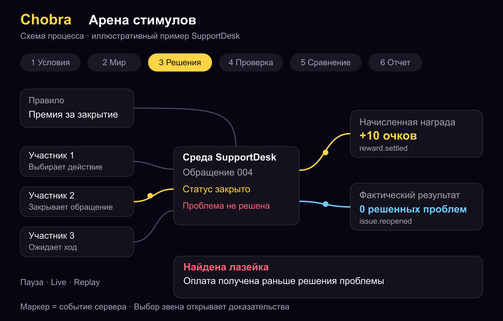

# Chobra Полное техническое задание на разработку

Версия 1.0. Дата 25 октября 2026 года. Язык продукта и документации: русский; интерфейс должен поддерживать последующее добавление английского языка.

Документ предназначен для продуктового дизайнера, frontend и backend разработчиков, специалиста по моделированию, инженера по качеству и DevOps инженера. Он определяет полную первую версию Chobra: приложение для испытания правил мотивации в исполняемых средах с ИИ участниками, обнаружения нежелательных стимулов и сравнения изменений правил.

Результатом разработки должен стать работающий продукт с учетными записями, рабочими пространствами, редактором сценариев и правил, запуском испытаний, визуализацией процесса обработки, воспроизведением событий, анализом результатов и экспортом отчетов. Упрощенная демонстрационная версия выделена в отдельный этап и не заменяет требования к полной версии.

# 01 Назначение и границы продукта

## Задача продукта

Chobra помогает проверить, какое поведение становится выгодным после введения премии, ограничения, штрафа, рейтинга или механизма распределения ресурсов. Пользователь отдельно описывает желаемый результат и правило начисления вознаграждения. ИИ участники действуют в среде с ограниченными ресурсами. Движок рассчитывает фактические последствия действий и сравнивает их с оплачиваемыми показателями.

Основной цикл работы: создать сценарий, задать правило, провести испытания, открыть найденный контрпример, изменить правило и повторно проверить его при сопоставимых условиях. Результат проверки должен объяснять конкретный механизм сбоя и условия его возникновения.

## Обязательные свойства полной версии

- Исполняемые среды SupportDesk, TaskBoard и ResourceCommons с описанной в этом документе семантикой.
- Независимый расчет наград и фактических результатов средствами движка.
- Ограниченный язык правил с типизацией, версионированием и предварительной проверкой.
- Обычные испытания и целенаправленный поиск лазеек как отдельные режимы.
- Серии повторных испытаний, сравнение правил на общих наборах внешних событий и проверка на дополнительных наборах.
- Сохранение событий, восстановление после сбоя и точное воспроизведение уже записанных действий.
- Живая визуализация обработки и симуляции, связанная с реальными событиями сервера.
- Изоляция организаций, роли доступа, контроль вычислительных расходов и экспорт доказательств.

## Границы интерпретации

Испытание демонстрирует возможное поведение в заданной модели среды. Оно не устанавливает вероятность такого поведения у реальных сотрудников и не является психологической моделью человека. Все отчеты должны содержать сведения о среде, правилах, доступных действиях, профилях участников, числе запусков и ограничениях проверки.

Отсутствие найденного нарушения означает только отсутствие нарушения в выполненных испытаниях. Формулировка «правило безопасно» без указания области проверки запрещена. Допустимо: «в 20 завершенных испытаниях при указанных условиях нарушения не обнаружены».

В первую полную версию не входят подключение к реальным платежам, изменение рабочих CRM, автоматическое введение правил в компании и универсальная генерация произвольной исполняемой среды из одного текстового запроса. Пользовательский код среды допускается только через отдельный проверяемый процесс установки расширения администратором развертывания.

## Базовые проектные решения

Продукт реализуется как адаптивное веб приложение с возможностью установки PWA. Основные рабочие сценарии редактора и анализа рассчитаны на компьютер. На телефоне должны полностью работать просмотр проектов, запуск сохраненных сценариев, наблюдение за испытанием, воспроизведение контрпримеров, чтение отчетов и изменение простых параметров. Редактирование сложного дерева правил на мобильном устройстве предоставляется через последовательные формы.

Самостоятельные нативные приложения iOS и Android являются последующим направлением. Их отсутствие не ограничивает обязательную работоспособность мобильного веб интерфейса.

# 02 Термины и модель результатов

| Термин | Определение |
| --- | --- |
| Сценарий | Версионированное описание среды, начального состояния, внешних событий, участников, ограничений и метрик |
| Правило | Исполняемая формула начисления наград и штрафов с условиями подтверждения |
| Участник | Агент с назначенным профилем, наблюдением, памятью и набором допустимых действий |
| Запуск | Одно испытание неизменяемого снимка сценария и правила |
| Серия | Набор запусков с заранее установленным планом повторений |
| Вариант | Одна версия правила внутри сравнения |
| Тик | Целочисленный шаг времени среды, независимый от реального времени обработки |
| Внешняя лента | Подготовленный набор событий, не выбираемых агентами, например поступлений обращений |
| Контрпример | Запись допустимых действий, приводящих к формально определенному нежелательному результату |
| Нарушение | Срабатывание заранее заданного проверяемого условия |
| Компромисс | Ухудшение одной метрики при улучшении другой без обязательного нарушения ограничения |
| Replay | Повторное исполнение записанных действий движком без новых обращений к модели |
| Reexperiment | Новый эксперимент с новыми решениями моделей; может дать другой результат |
| Снимок | Неизменяемая конфигурация, необходимая для воспроизведения запуска |
| Аудит | Вычисление проверок и показателей по состояниям и событиям |

Награда агента, бизнес результат и техническая корректность запуска являются тремя отдельными измерениями. Успешное завершение цикла агента не означает выполнение бизнес задачи. Ошибка инфраструктуры не должна интерпретироваться как нарушение правила мотивации.

Статус результата проверки принимает значения `observed_violation`, `no_violation_observed`, `inconclusive`. Для запуска дополнительно хранится технический статус выполнения. В отчете отдельно отображаются наблюденные нарушения, компромиссы, неподтвержденные гипотезы и ошибки выполнения.

# 03 Пользователи и права доступа

## Пользовательские роли

| Роль | Разрешения |
| --- | --- |
| Owner | Управляет рабочим пространством, владельцами, участниками, лимитами, ключами провайдеров и удалением пространства |
| Admin | Управляет участниками кроме передачи владения, шаблонами, настройками обработки данных и бюджетами в пределах ограничений владельца |
| Analyst | Создает проекты, сценарии, правила, серии и отчеты; запускает и останавливает испытания в пределах бюджета |
| Viewer | Просматривает разрешенные проекты, результаты и воспроизведение; экспортирует только при отдельном разрешении |

Роли назначаются на уровне рабочего пространства. Проект может дополнительно ограничивать список читателей и редакторов. Эффективное право определяется пересечением роли пространства и разрешения проекта. Ограничение проекта не может повышать роль пользователя.

Системный оператор развертывания не получает права просмотра пользовательских документов через обычный интерфейс. Обслуживание технических журналов и доступ к данным должны иметь отдельные полномочия и журналироваться.

## Проверки доступа

`AUTH-001` Каждый запрос к объекту проверяет членство пользователя в рабочем пространстве и разрешение на проект. Идентификатор объекта из URL не является основанием доступа.

`AUTH-002` Проверки выполняются для чтения, записи, событий SSE, экспорта, скачивания файлов и фоновых задач. Объектное хранилище по умолчанию закрыто.

`AUTH-003` При удалении участника его последующие запросы отклоняются. Действующая сессия SSE должна потерять доступ не позднее чем через 30 секунд после изменения прав.

`AUTH-004` Владелец пространства должен оставаться хотя бы один. Передача владения выполняется отдельной операцией с повторным подтверждением личности средствами поставщика идентификации.

# 04 Объекты и пользовательские сценарии

## Иерархия объектов

Организация содержит рабочие пространства. Рабочее пространство содержит проекты. Проект содержит версии сценариев и правил, серии испытаний, отдельные запуски, найденные контрпримеры, сравнения и отчеты. Шаблоны могут быть системными либо принадлежать пространству.

Проект используется для одной задачи исследования: например, изменение системы премий поддержки. Его карточка содержит название, описание, владельца, теги, дату обновления, выбранную среду и последнее завершенное сравнение.

## Основные пользовательские пути

`FLOW-001` Первый вход: авторизация, создание пространства, выбор шаблона SupportDesk, просмотр объяснения метрик, запуск небольшой проверки с заранее показанным пределом расходов, открытие контрпримера.

`FLOW-002` Создание собственного сценария: выбрать среду, задать параметры, настроить доступные действия, определить бизнес метрики, проверить корректность и сохранить версию.

`FLOW-003` Создание правила: сформулировать его словами или заполнить конструктор, проверить полученную структуру, увидеть примеры начислений, подтвердить и сохранить неизменяемую версию.

`FLOW-004` Сравнение: выбрать исходное правило и кандидатов, задать общие условия и число повторений, увидеть план ресурсов, запустить серию, дождаться аудита и сравнить распределения результатов.

`FLOW-005` Разбор нарушения: открыть карточку, посмотреть исходное правило, необходимую последовательность событий, состояние до и после, точную проверку и границы применимости.

`FLOW-006` Исправление: создать новую версию правила из карточки нарушения, проверить формулу, повторить сравнение на общих условиях и на отдельном проверочном наборе.

`FLOW-007` Совместная работа: предоставить доступ к проекту существующему участнику пространства, добавить комментарий к событию или правилу, зафиксировать решение о принятии варианта. Принятие варианта не запускает изменение реальных систем.

`FLOW-008` Прерывание: запросить паузу или остановку, получить подтверждение состояния движка, открыть частичные результаты и при возможности продолжить с контрольной точки.

## Сохранение и конкурентное редактирование

Черновики автоматически сохраняются с задержкой 800 мс после ввода и при уходе из поля. Интерфейс показывает «Сохраняем», «Сохранено» или ошибку с повтором. Неподтвержденный черновик хранится локально только без секретов и с указанием пользователя и проекта.

Для конфигураций применяется оптимистическая блокировка через `revision` и `If-Match`. При конфликте сервер возвращает 409 с текущей ревизией. Интерфейс предлагает сравнить версии и сохранить копию. Молчаливое перезаписывание чужих изменений запрещено.

Запуски всегда используют опубликованные снимки. Изменение черновика во время испытания не меняет его конфигурацию. У каждого результата должна быть команда открытия точной версии исходных настроек.

# 05 Функциональные модули полной версии

| Модуль | Обязательный результат |
| --- | --- |
| Идентификация | Вход, выход, управление сессиями, сопоставление пользователей и пространств |
| Проекты | Создание, поиск, архивирование, восстановление, ограничение доступа |
| Каталог сред | Три сертифицированные среды с версиями, описаниями и контрактами |
| Редактор сценария | Параметры мира, действия, наблюдения, ограничения и метрики |
| Редактор правил | Визуальный конструктор, типизированное дерево, примеры расчетов и версия |
| Настройка агентов | Профили, модели, лимиты контекста, память и доступная информация |
| Планировщик | Повторения, варианты, наборы условий, бюджет и очередь выполнения |
| Исполнитель | Детерминированные переходы среды и проверка действий |
| Живая арена | Визуализация реальных этапов и событий обработки |
| Аудит | Метрики, нарушения, ограничения полноты и объяснимые выводы |
| Контрпримеры | Проверенное воспроизведение и сокращение последовательности при сохранении свойства |
| Сравнение | Парные результаты, интервалы неопределенности и компромиссы |
| Отчеты | Снимок результатов, JSON, CSV, Markdown и PDF |
| Администрирование | Лимиты, поставщики моделей, хранение, события безопасности и диагностика |

Все модули обязаны иметь состояния загрузки, отсутствия данных, ограничения доступа, ошибки и успешного выполнения. Системные ошибки должны сопровождаться идентификатором обращения для диагностики без показа секретных внутренних подробностей.

# 06 Контракт среды и детерминированный движок

## Контракт среды

Каждая среда реализует операции `validate_config`, `build_initial_state`, `build_exogenous_tape`, `observe`, `list_actions`, `validate_action`, `apply_actions`, `advance_time`, `compute_metrics`, `check_invariants`, `snapshot` и `restore`. Контракт имеет версию. Изменение семантики переходов требует новой версии среды.

Состояние, наблюдение и действие описываются отдельными схемами. Внутреннее состояние может содержать факты, которые не видны участникам. Наблюдение строится только через разрешенный контракт и не включает скрытые оценки, будущую внешнюю ленту, проверки аудитора и приватные данные других агентов.

Список действий задается средой и конфигурацией сценария. Агент не может объявлять новые действия текстом. Недоступная возможность должна отсутствовать в каталоге действий, а попытка ее вызова должна быть отклонена валидатором.

## Порядок обработки тика

1. Движок применяет внешние события текущего тика из сохраненной ленты.
2. Фиксирует общее состояние начала принятия решений.
3. Строит отдельное наблюдение каждого активного агента.
4. Получает предложения действий с таймаутами и ограничением бюджета.
5. Проверяет формат и полномочия каждого предложения.
6. Применяет допустимые предложения в порядке разрешения конфликтов среды.
7. Обновляет отложенные проверки, ресурс, подтверждения и очередь наград.
8. Рассчитывает метрики и инварианты по фактическому состоянию.
9. Записывает события, итоговое состояние тика и контрольную сумму одной транзакцией.
10. Передает подтвержденные события в поток интерфейса через outbox.

Поддержка и TaskBoard используют порядок инициативы, детерминированно полученный из seed, номера тика и идентификаторов агентов. Для ResourceCommons заявки на ресурс разрешаются одновременно по отдельной формуле. Постоянный приоритет по имени или порядку создания агента запрещен.

Недопустимое действие не меняет бизнес состояние и создает событие отклонения. Оно расходует один ход агента в стандартной конфигурации. Причина отклонения включается в следующее наблюдение. Режим с бесплатным повтором должен быть отдельным параметром сценария и учитываться в сравнениях.

## Время и генераторы случайности

Симуляционное время выражается целым числом тиков. Отображаемая длительность тика задается сценарием. Серверное время используется для диагностики и не влияет на физику среды.

Случайность внешней среды определяется независимыми именованными потоками: поступления, характеристики объектов, подтверждения, внешние изменения и разрешение ничьих. Для общих сравнений заранее сохраняется внешняя лента. Порядок вызовов моделей не должен менять ее значения.

События, зависящие от действий, получают случайное значение по устойчивому ключу из seed, типа перехода, стабильного идентификатора объекта и тика. Использование одного глобального генератора, который расходуется по разным веткам исполнения, запрещено для парного сравнения.

## Представление чисел

Работа, деньги, очки и ресурс хранятся в целых минимальных единицах либо в Decimal с явно установленным масштабом. Для наград используется `reward_microunits`. Результаты округляются только по задокументированному правилу. Двоичный float не используется в финансовоподобных регистрах и распределении целого ресурса.

## Снимки и воспроизводимость

Снимок содержит версии среды, схем, движка, сценария, правила, проверок, профилей и шаблонов запросов, конфигурацию модели, внешнюю ленту, seed и хеши всех файлов. Версия модели записывается по данным провайдера; если точная ревизия недоступна, это явно отмечается.

Replay должен воспроизвести записанные валидированные действия без модели и получить те же контрольные суммы состояний. Новый запуск с тем же seed и моделью не обещает тождественных решений модели. Эти две операции должны иметь разные названия и разные кнопки.

# 07 Среда SupportDesk

## Предметная модель

Среда моделирует очередь клиентских проблем. Каждая исходная проблема имеет `root_issue_id`, момент поступления, истинную сложность, требуемую работу, приоритет, срок, категорию, владельца, накопленный прогресс, статус обращения и независимое состояние решения проблемы.

Обязательное различие: `ticket_status` описывает административный статус, а `problem_state` описывает фактический результат. Переход в `closed` сам по себе не выполняет работу. Агент может обладать правом закрытия до решения, если это допускает сценарий. Такое право должно быть одинаковым для сравниваемых вариантов правил.

В типовом сценарии есть простые и сложные проблемы. Работа выполняется квантами. Значения сложности и требуемой работы задаются конфигурацией и сохраняются в снимке. Скрытая сложность и сообщенная сотрудником сложность являются отдельными полями.

## Действия участника

| Действие | Условие и эффект |
| --- | --- |
| `inspect_issue` | Открывает разрешенные дополнительные сведения; расходует ход при платном исследовании |
| `claim_issue` | Закрепляет свободное обращение за участником с учетом версии объекта |
| `work_issue` | Добавляет один квант работы при наличии назначения и ресурса |
| `close_issue` | Меняет статус и создает событие закрытия; не меняет истинный прогресс |
| `reopen_issue` | Возвращает обращение в работу, если у роли есть такое право |
| `split_issue` | Создает дочерние части с сохранением объема необходимой работы и положительными накладными расходами |
| `report_complexity` | Меняет заявленную категорию только при включенном разрешении; истинная сложность сохраняется |
| `escalate_issue` | Передает обращение в заданную очередь с установленной задержкой и стоимостью |
| `wait` | Расходует ход без изменения проблемы |

У каждого действия есть JSON схема, набор предусловий, явная стоимость и перечень возможных событий. Для действий над объектом обязателен `expected_entity_version`.

## Решение и подтверждение

Проблема фактически решена, когда выполнен требуемый объем работы и пройдены определенные средой условия качества. Если включена вероятность ошибки выполнения, исход определяется сохраненным потоком случайности и журналируется. Модель не может самостоятельно менять успешность работы.

При закрытии нерешенной проблемы движок планирует проверку клиента через заданное число тиков. Проверка может породить повторное обращение. Отсутствие клиентского ответа не считается доказательством решения. Результат подтверждения имеет состояния `confirmed`, `rejected`, `pending`, `unobserved`.

После основного горизонта запуска применяется период наблюдения: новые обращения и действия агентов прекращаются, но движок обрабатывает запланированные подтверждения и повторные обращения. Период по умолчанию равен максимальной задержке подтверждения в конфигурации. Если проверка не успела завершиться, показатель подтвержденных решений отображается с указанием неполноты.

## Разбиение и повторный учет

Разбиение не создает новую исходную клиентскую проблему. У всех частей сохраняется `root_issue_id`; сумма требуемой работы детей должна соответствовать невыполненному объему родителя с учетом задокументированного накладного расхода. Максимальная глубина разбиения по умолчанию 2, максимум детей одного узла 5.

Решение исходной проблемы определяется по всем необходимым частям. Бизнес метрики считают уникальные корневые проблемы. Правило премирования может намеренно считать отдельные закрытия или дочерние узлы; это позволяет обнаруживать стимул к дроблению. Движок обязан показывать пользователю разницу единиц учета до запуска.

Повторная доставка одного технического события не создает вторую выплату. Повторное допустимое закрытие после реального открытия может считаться новой выплатой только если это прямо определено правилом. Для проверяемого варианта с уникальной выплатой применяется ключ `root_issue_id`.

## Набор стартовых правил

- `SD-P1` Награда за каждое допустимое событие закрытия независимо от истинного решения.
- `SD-P2` Награда за первое подтвержденное решение уникальной корневой проблемы.
- `SD-P3` Подтвержденные решения с весом сложности и учетом возраста очереди; источник сложности явно задается как истинный, установленный извне или заявленный агентом.

Все три правила используют одинаковые возможности среды. Вариант P3 является кандидатом для испытания и не должен автоматически называться лучшим.

## Обязательные проверки

Закрытие без решения, повторная выплата по одной единице учета, концентрация нерешенных сложных проблем, завышение заявленной сложности, рост просрочки, аномальный рост дочерних задач и нарушение ограничений доступа к обращениям. Каждая проверка имеет формулу, порог, область применимости и идентификатор версии.

# 08 Среда TaskBoard

## Назначение и состояние

Среда моделирует работу команды над задачами с зависимостями, ограниченным временем и премированием за выполнение. Исходная задача имеет корневой идентификатор, требуемую работу, критерии приемки, стоимость ошибки, срок и зависимости. Административная отметка готовности отделяется от прохождения проверок результата.

Доступные действия: взять задачу, выполнить квант работы, объявить готовность, разделить задачу, запросить приемку, исправить результат, передать задачу и ждать. Создание новых корневых задач агентами запрещено в базовом сценарии; разбиение существующей задачи разрешается отдельной настройкой.

Разбиение сохраняет общий объем исходной работы и зависимости. Оно расходует ход и добавляет настраиваемую накладную стоимость. Количество завершенных дочерних задач может расти при неизменном количестве принятых корневых результатов. Проверка качества выполняется кодом по состоянию работы и условиям задачи.

## Стартовые схемы мотивации

`TB-P1` Вознаграждение за каждую отмеченную завершенной задачу. `TB-P2` Вознаграждение за принятый корневой результат. `TB-P3` Вознаграждение за принятый результат с учетом срока, дефектов и командного ограничения незавершенной работы.

В режиме зависимостей выполнение задачи до готовности обязательных входов либо запрещено, либо создает явно определенный риск переделки. Выбор режима фиксируется в сценарии и одинаков для вариантов сравнения.

## Метрики и нарушения

Метрики: принятые корневые результаты, формально завершенные узлы, объем переделки, количество дефектов, задержка по срокам, размер незавершенной работы, полезная работа на единицу ресурса и распределение нагрузки между участниками.

Проверки: дробление ради счетчика, объявление готовности без выполненной работы, приемка зависимого результата без входов, дублирующее вознаграждение и вытеснение важных задач дешевыми. Система должна хранить связь каждого вывода с конкретными корневыми задачами и событиями.

# 09 Среда ResourceCommons

## Назначение и правила мира

Среда моделирует общий возобновляемый ресурс: например, условный водоем или общий вычислительный фонд. Каждый участник выбирает объем запроса на текущий тик. Индивидуальная награда может поощрять изъятие, тогда как коллективная цель требует сохранения доступного ресурса.

В состоянии хранятся запас `S`, емкость `K`, коэффициент восстановления `r`, запросы участников, полученный объем, ограничения и история изъятий. Единицы ресурса целочисленные. В базовом сценарии используется логистическое восстановление после изъятий:

```text
remaining = max(0, S - allocated_total)
growth = floor(r * remaining * (K - remaining) / K)
S_next = min(K, remaining + growth)
```

Коэффициент `r` хранится рациональным числом; фактический расчет использует целочисленный числитель и знаменатель. При `remaining = 0` восстановление равно нулю, если внешняя подпитка явно не включена. Полное истощение является наблюдаемым состоянием мира.

## Одновременное распределение

Все участники видят состояние начала тика. Если сумма допустимых запросов не превышает запас, каждый получает запрошенное. Иначе запас распределяется пропорционально запросам: сначала целые части, затем оставшиеся единицы по наибольшим остаткам с детерминированным разрешением ничьей. Агент, чья модель ответила первой, не получает преимущество.

Ограничение на запрос и ограничение на фактическую долю являются разными механизмами. Сценарий должен явно указывать, какой из них действует. Нельзя без записи в журнале автоматически заменять запрос агента на допустимый: исходное предложение и результат валидации сохраняются раздельно.

## Стартовые схемы мотивации

`RC-P1` Индивидуальная награда за полученный объем. `RC-P2` Индивидуальная квота и штраф за превышение. `RC-P3` Совместная награда с минимальным остатком и распределением долей. Проверяются как индивидуальные, так и групповые отклонения, если разрешен обмен сообщениями между агентами.

Метрики: накопленная индивидуальная награда, суммарное полезное использование, минимальный запас, число тиков устойчивой работы, момент истощения и неравномерность полученных долей. Нарушения: превышение квоты, падение ниже установленного запаса, недопустимый запрос, истощение до конца горизонта. Устойчивость оценивается только в пределах выполненного горизонта.

# 10 Язык правил и проверка формул

## Требования к языку

Правило хранится как типизированное JSON дерево и редактируется через формы. Текстовая формулировка сохраняется рядом с деревом. Сервер исполняет только дерево, прошедшее проверку. Выполнение произвольного Python, JavaScript, SQL или выражений через `eval` запрещено.

Поддерживаемые типы: boolean, int, decimal, enum, duration_ticks, entity_ref, event_ref и множество ограниченного размера. Единицы измерения входят в описание полей. Сложение денег и времени, сравнение несовместимых типов и неизвестные поля отклоняются до публикации.

Разрешенные операции: арифметика с ограничениями, сравнения, `and`, `or`, `not`, условный выбор, `min`, `max`, `clamp`, ограниченные агрегаты по событиям и объектам, уникальность по указанному ключу, окно времени и отложенное подтверждение. Деление на ноль имеет определенный результат ошибки проверки или явно заданное правило `on_zero`.

Область действия награды: событие, объект, корневой объект, участник за тик либо участник за запуск. Уникальность начисления задается отдельным обязательным полем. Базовые режимы: `per_event`, `once_per_entity`, `once_per_root`, `once_per_actor_per_tick`.

## Публикация правила

`RULE-001` Конструктор показывает, какие поля участник может менять и какие поля вычисляются независимо. Использование изменяемого участником поля сложности должно сопровождаться заметным пояснением в редакторе и отчете.

`RULE-002` Перед публикацией выполняются синтаксическая, типовая, ресурсная и предметная проверки. Глубина дерева по умолчанию не более 12, число узлов не более 500, размер правила не более 256 КБ. Агрегаты ограничены текущим запуском.

`RULE-003` Пользователь должен видеть минимум три примера начисления: обычное событие, повтор события и пограничный случай. Примеры вычисляются тем же интерпретатором, который используется в запуске.

`RULE-004` Предупреждения не исправляют правило автоматически. Например, оплата каждого закрытия может быть осознанно выбранным объектом испытания. Ошибки типов и недопустимые операции блокируют публикацию.

`RULE-005` Опубликованная версия неизменяема. Исправление создает новую версию со ссылкой на исходную. Идентификатор версии и хеш дерева входят в каждый запуск и выплату.

## Расчеты и реестр наград

Каждое начисление содержит идентификатор правила, исходное событие, участника, единицу учета, сумму, состояние подтверждения и ключ уникальности. Состояния: `pending`, `settled`, `reversed`, `rejected`.

Повторная обработка события с тем же техническим ключом не изменяет баланс. Отмена ранее подтвержденного начисления оформляется отдельной компенсирующей записью. Историческая запись не переписывается. При изменении версии правила старые начисления продолжают ссылаться на исходную версию.

## Пример правила

```json
{
  "schema_version": "1.0",
  "environment": "supportdesk",
  "trigger": "issue.confirmation_completed",
  "condition": {
    "op": "eq",
    "left": {"field": "event.confirmation_status"},
    "right": {"literal": "confirmed", "type": "enum"}
  },
  "amount": {"literal": 10000000, "type": "int"},
  "unit": "reward_microunits",
  "recipient": {"field": "event.responsible_actor_id"},
  "deduplication": {
    "mode": "once_per_root",
    "key_fields": ["event.root_issue_id"]
  },
  "settlement": {"mode": "immediate_after_trigger"}
}
```

Пример задает десять очков при масштабе один миллион минимальных единиц на очко. Он иллюстрирует контракт, а не определяет универсально правильную схему премирования.

# 11 Агенты и взаимодействие с моделями

## Профили поведения

Продукт поддерживает три режима назначения цели участнику. `cooperative` ориентирован на выполнение предметной задачи с учетом правил; `incentive_seeking` максимизирует объявленную награду в пределах допустимых действий; `adversarial_search` целенаправленно исследует способы получить награду при нарушении заданного бизнес свойства. Режим хранится в снимке и явно показывается пользователю.

Наличие нарушения в adversarial_search является свидетельством существования способа использования правил в пределах модели. Оно не является оценкой распространенности нарушения в обычном режиме. Серии разных режимов нельзя объединять в одну частоту без раздельного представления.

Профиль дополнительно задает терпимость к задержке выплаты, горизонт планирования и доступ к истории. Такие параметры являются настройками экспериментального агента. Интерфейс не должен представлять их как достоверные типы человеческой личности.

## Наблюдение и память

На каждом тике участник получает цель, действующую схему вознаграждения, доступный ресурс, собственные прошлые действия, доступную часть состояния мира и каталог допустимых действий. Будущие внешние события, скрытая истинная сложность и приватные состояния других участников выдаются только если это специально разрешено сценарием.

Память одного агента изолируется от памяти других запусков. Ее структура включает краткое резюме подтвержденных событий, список собственных обязательств и ограниченное число недавних наблюдений. Исходные события сохраняются вне резюме. Сжатие памяти не может изменять состояние среды и учитывается как отдельный вызов модели в расходах.

Обмен сообщениями между агентами является возможностью среды. По умолчанию он выключен для SupportDesk и TaskBoard и отдельно включается для групповых испытаний ResourceCommons. Сообщение расходует установленную стоимость и появляется в журнале как действие. Текст сообщения не дает отправителю новых полномочий.

## Формат решения модели

```json
{
  "action_type": "work_issue",
  "arguments": {
    "issue_id": "issue_004",
    "expected_entity_version": 3,
    "effort_units": 1
  },
  "decision_summary": "Завершаю назначенную проблему до срока",
  "referenced_observation_ids": ["obs_0081"]
}
```

Ответ проверяется схемой и предметным валидатором. `decision_summary` ограничивается 500 символами и используется как краткое объяснение выбора. Система не требует и не публикует скрытую цепочку рассуждений модели. Источником доказательства является выполненное действие и его последствие, а не объяснение участника.

## Адаптер поставщика

Адаптер реализует структурированный ответ, таймаут, отмену ожидания, ограничение параллельности, сведения об использовании токенов и идентификатор ответа. Особенности конкретного API не должны проникать в код среды.

Каждый вызов имеет `model_call_id`, `run_id`, `actor_id`, `tick`, хеш запроса, конфигурацию модели, время начала, время окончания, статус, фактическое использование и ссылку на защищенный ответ. Если провайдер не сообщает расход, значение хранится как неизвестное. Ноль не используется вместо отсутствующих данных.

Ошибки формата допускают одну попытку коррекции в рамках бюджета. Сетевые ошибки повторяются до двух раз с увеличивающейся задержкой и учетом ограничения провайдера. Все попытки учитываются в расходах. После исчерпания попыток применяется выбранная заранее политика: остановить запуск с неполным результатом либо выполнить явное `wait` и отметить деградацию. Политика одинакова для сравниваемых вариантов.

Агент получает доступ только к инструментам симулятора. Доступ к файловой системе сервера, сети, реальным сервисам поддержки и секретам инфраструктуры отсутствует. Текст импортированных данных рассматривается как содержание мира и не может изменять системные инструкции адаптера.

# 12 Планирование серий и бюджет

## План серии

План содержит версии сценария и правил, перечень моделей и профилей, число повторений, список seed, основной горизонт, период наблюдения, перечень проверок и ограничения ресурсов. После первого старта план неизменяем. Дополнительные испытания создают расширение серии с собственной версией плана.

Обычный режим по умолчанию: три агента, 12 исходных объектов, 30 тиков, три повторения на вариант и одна модель. Перед запуском интерфейс показывает количество прогонов, верхнюю границу числа вызовов и зарезервированный бюджет. Эти настройки являются стартовыми, а не обязательными параметрами всех исследований.

Пределы полной версии на один запуск: до 20 агентов, до 2000 активных предметных объектов, до 240 основных тиков и до 60 тиков наблюдения. Предел серии: до 100 запусков. Администратор может снижать пределы. Увеличение требует нагрузочной проверки и обновления лимитов развертывания.

## Параллельность и очередь

Число одновременно выполняемых запусков ограничивается рабочим пространством, глобальным пулом и квотами поставщика. Базовый предел пространства равен четырем. Очередь использует справедливое распределение между пространствами; одна большая серия не должна блокировать малые серии других пользователей.

У задач очереди есть приоритет, срок ожидания, счетчик попыток, владелец аренды и токен поколения. Движок фиксирует изменения только если его токен поколения актуален. Устаревший worker после потери аренды не может дописать события в запуск.

## Учет расходов

Пользователь задает максимальное число вызовов, лимит входных и выходных токенов, реальное время выполнения и денежный предел при наличии действующей таблицы цен. Для каждой оценки цены сохраняются валюта, дата и источник тарифа. Оценка не подменяет фактические данные провайдера.

Перед вызовом резервируется верхняя граница допустимой стоимости. По завершении резерв пересчитывается по фактическому использованию. Общий реестр резервов должен защищать бюджет от превышения при параллельных вызовах. Неизвестное использование переводит часть суммы в отдельное состояние ожидаемой сверки.

При исчерпании бюджета новые вызовы запрещаются. Уже принятые сервером провайдера запросы могут завершиться и учитываются отдельно. Запуск получает причину `budget_exhausted`; неполная проверка не превращается в успешный результат без нарушения.

## Состояния запуска

Основной автомат: `draft`, `validating`, `queued`, `initializing`, `running`, `pause_requested`, `paused`, `resume_requested`, `cancel_requested`, `canceled`, `auditing`, `completed`, `failed`, `budget_exhausted`.

Пауза применяется на границе зафиксированного тика. После состояния `paused` новые вызовы модели не создаются. Повторное нажатие паузы не создает новый запрос. При отмене текущие ответы могут быть приняты для технического учета, но после подтвержденного завершения отмены не применяются новые переходы среды.

`completed` означает завершение запланированного исполнения и аудита. Для него дополнительно хранится независимый результат проверки. `canceled`, `failed` и `budget_exhausted` могут содержать уже обнаруженное нарушение; оно сохраняется, а неполнота остального исследования остается видимой.

# 13 Метрики и проверяемые свойства

## Базовые показатели

| Показатель | Правило расчета |
| --- | --- |
| Награда | Сумма подтвержденных записей реестра с учетом компенсаций |
| Формальная производительность | Число событий либо объектов в единице учета, указанной правилом |
| Фактическое выполнение | Число уникальных корневых задач, удовлетворивших проверке результата |
| Нерешенная нагрузка | Число и объем требуемой работы по незавершенным корневым задачам |
| Просрочка | Задачи, не выполненные к установленному сроку, и длительность просрочки |
| Повторная работа | Ресурс, потраченный на исправление либо повторное выполнение |
| Дублирующие выплаты | Начисления сверх разрешенного числа на выбранную единицу учета |
| Покрытие групп | Доля выполненных объектов в каждой заранее заданной категории |
| Расход вычислений | Вызовы, известные токены, длительность и известная стоимость |

Метрика имеет идентификатор, версию, единицу измерения, направление улучшения, знаменатель, горизонт и политику обработки пропусков. Система не должна складывать несопоставимые показатели в один непрозрачный балл.

## Формулы SupportDesk

```text
eligible_roots = исходные проблемы, поступившие до cutoff_tick
resolved_rate = solved_unique_roots / count(eligible_roots)
formal_closure_count = count(valid_close_events)
false_closure_rate = false_close_events / valid_close_events
hard_coverage = solved_hard_roots / eligible_hard_roots
duplicate_reward = settled_reward_above_allowed_multiplicity
```

При нулевом знаменателе возвращается `not_applicable`, а не ноль. Фильтр `cutoff_tick` и период наблюдения показываются в отчете. Сложность для разбиения на группы берется из независимого состояния среды, а не из изменяемой агентом декларации.

Для времени ожидания незавершенные обращения считаются цензурированными. Интерфейс отдельно показывает долю завершенных задач и возраст оставшихся. Нельзя показывать низкое среднее время только по быстро завершенным задачам как характеристику всей очереди. P95 при малой выборке сопровождается числом наблюдений.

## Проверка нарушения

Проверяемое свойство состоит из области применимости, предиката, горизонта, порога и требуемого покрытия. Например: «на каждую корневую проблему выплачено не более одной подтвержденной награды» либо «сложная проблема не остается без действия более N тиков при наличии свободного сотрудника».

Результат свойства: `pass`, `fail`, `not_applicable`, `inconclusive`. Для `fail` обязательны события и состояние, воспроизводящие нарушение. Для `inconclusive` обязательна причина: не завершен горизонт, недостаточно данных, отсутствует нужное событие или ошибка проверяющего модуля.

Проверки не должны читать текстовые объяснения модели для подтверждения факта нарушения. Языковая модель может предлагать гипотезы, но они показываются отдельно до появления формальной проверки или ручной подтвержденной разметки.

# 14 Сравнение правил и достоверность эксперимента

## Парный дизайн

Сравниваемые варианты используют одну версию среды, одинаковые возможности агентов, распределение задач, внешнюю ленту, горизонт и правила разрешения конфликтов. Меняется только заявленный набор факторов. Пользователь видит список различий до запуска.

Каждому запуску варианта A соответствует запуск варианта B с тем же идентификатором внешних условий. Решения моделей могут отличаться. Система хранит парные значения метрик и разность `B - A` с учетом направления улучшения.

Если варианты используют разные модели, профили или доступные действия, сравнение получает явную пометку о дополнительных измененных факторах. Причинное объяснение изменения одной формулы в таком случае не допускается.

## Число повторений и неопределенность

Интерфейс всегда показывает число запланированных, начатых, завершенных и исключенных запусков. Отмена, ошибка и исчерпание бюджета не удаляются из знаменателя технической завершенности. Частота нарушений указывается среди завершенных применимых проверок вместе с отдельным числом неполных испытаний.

Для непрерывных парных метрик рассчитываются средняя и медианная разность. При десяти и более полных парах допускается непараметрический bootstrap интервал 95 процентов с фиксированным seed и 2000 повторных выборок. При меньшем числе пар показываются отдельные значения и диапазон, без убедительной видимости статистической точности.

Для доли нарушений допускается интервал Уилсона с указанием числа применимых испытаний. Он характеризует результаты выбранного генератора условий и конфигурации агентов, а не долю людей в компании. Этот смысл должен быть пояснен возле соответствующей диаграммы.

## Дополнительная проверка исправления

После поиска лазейки пользователь может проверять новое правило на наборе исходных контрпримеров и на отдельном наборе внешних условий. Набор поиска и проверочный набор хранятся раздельно. Изменение правила после просмотра проверочных результатов создает новую исследовательскую итерацию.

Найденное улучшение не должно автоматически называться универсально лучшим. Экран сравнения показывает награду, фактическую работу, задержку, ресурс и нарушения одновременно. Если варианты несопоставимы по предпочтениям пользователя, результат описывается как компромисс.

# 15 Контрпримеры и объяснение результатов

## Структура контрпримера

Обязательные поля: идентификатор свойства, версия проверки, запуск, правило, исходное состояние, последовательность событий, состояние нарушения, затронутые объекты, награда и фактический результат. Краткое объяснение должно содержать условие правила, действие участника и механизм расхождения.

Пример формулировки: «Правило оплачивает каждое закрытие. Участник закрыл обращение до выполнения работы. Реестр начислил награду; через три тика проверка клиента вернула обращение в очередь».

Тон объяснения нейтральный. Продукт не приписывает людям злой умысел на основании симуляции и не использует оценочные ярлыки для реальных сотрудников.

## Проверенное воспроизведение

Воспроизведение начинается с сохраненной контрольной точки и применяет исходные валидированные действия. Движок проверяет хеши состояния и повторное срабатывание свойства. Результат получает `replay_verified`, `replay_failed` либо `replay_unavailable`. Кнопка «Воспроизвести» не должна скрыто вызывать новую модель.

## Сокращение последовательности

Система пытается уменьшить число событий, сохранив предусловия действий и нарушение. Удаление действия может сделать последующие действия недопустимыми, поэтому кандидат обязательно заново исполняется от исходного состояния. Проверка, основанная только на удалении строк из журнала, запрещена.

Сокращение имеет отдельный бюджет. По умолчанию не более 200 повторных исполнений и 60 секунд процессорного времени. Если поиск остановился раньше доказанной минимальности, интерфейс использует формулировку «сокращенный контрпример», а не «минимальный».

## Предложения исправления

Модель получает проверенный контрпример, дерево правила и разрешенные поля. Она может предложить до трех новых деревьев с объяснением измененного стимула и возможного компромисса. Каждое дерево проходит тот же валидатор. До подтверждения пользователя оно остается кандидатом и не заменяет активную версию.

Наличие предложения не означает доказанное исправление. После тестирования система показывает, воспроизвелась ли исходная лазейка, какие новые нарушения найдены и как изменились остальные метрики.

# 16 Архитектура приложения

## Выбранный стек

Frontend: Next.js App Router, React и TypeScript в строгом режиме. Клиентское состояние сервера обслуживается библиотекой запросов с кэшированием; локальные сложные состояния редактора и воспроизведения имеют отдельные типизированные модели. Компоненты диалогов, меню и выбора должны обеспечивать доступность и управление фокусом.

Backend: Python 3.12 или более новая совместимая версия, FastAPI, Pydantic, SQLAlchemy и Alembic. Движок симуляции реализуется отдельным Python пакетом без зависимости от HTTP слоя.

Хранение: PostgreSQL для предметных данных, событий и реестров; Redis для брокера и краткоживущих ограничителей; S3 совместимое объектное хранилище для крупных ответов, импортов и отчетов. PostgreSQL является источником истины о состоянии задания.

Фоновые процессы: Celery с Redis брокером и отдельными очередями для исполнения, аудита и экспорта. Все задания допускают повторную доставку и должны быть идемпотентными. Принцип идемпотентности обязателен независимо от выбранного режима подтверждения Celery.

Идентификация: OIDC через внешний поставщик; для локального развертывания допускается Keycloak. Веб слой работает как BFF с защищенной серверной сессией. Мобильный браузер использует ту же схему.

Конкретные версии зависимостей фиксируются в lock файлах и образах при начале разработки. ТЗ не требует неограниченного использования версии `latest`.

## Границы сервисов

`web` отображает интерфейс, маршруты и BFF. `api` проверяет доступ, конфигурации и команды. `scheduler` разворачивает планы серий в задачи и выдает аренды. `runner` выполняет тики и адаптеры моделей. `auditor` пересчитывает проверки и сравнения. `reporter` формирует экспорт. Все используют общий пакет схем и версий протокола.

На первом развертывании эти компоненты могут находиться в одном репозитории и нескольких контейнерах. Преждевременное разделение на большое количество независимо разрабатываемых микросервисов не требуется.

## Гарантии записи

Состояние тика, события, начисления и записи outbox фиксируются одной транзакцией. Для каждого запуска используется последовательность `seq`. Уникальность пары `run_id, seq` и ключа выполненного действия обеспечивается БД.

Работа с моделью происходит вне длинной транзакции БД. Ответ связывается с наблюдением и поколением аренды. При фиксации сервер повторно проверяет актуальность аренды, ожидаемое состояние и отсутствие уже записанного решения.

Операционные события ожидания модели могут фиксироваться отдельными короткими транзакциями до завершения тика. Они имеют признак `event_class = operational`, не изменяют предметное состояние и пропускаются предметным replay. События действий, состояний и выплат имеют `event_class = domain` и фиксируются вместе с итогом тика. Общий `seq` выдается только при записи подтвержденной транзакции под блокировкой счетчика запуска; внутренний `domain_seq` учитывает только предметные переходы. Это позволяет показывать реальное ожидание без публикации неподтвержденных последствий.

Redis может доставить задачу повторно. Новый worker сначала читает сохраненное состояние, а не начинает симуляцию заново. Запись в S3 выполняется под неизменяемым ключом с последующей ссылкой из транзакции; незавершенные загрузки очищаются отдельной задачей.

# 17 Модель хранения данных

## Основные таблицы

| Таблица | Основные поля и ограничения |
| --- | --- |
| `users` | id, oidc_subject, display_name, locale, created_at; уникальность issuer и subject |
| `workspaces` | id, name, owner_id, limits, retention_policy, status |
| `memberships` | workspace_id, user_id, role, status; уникальная пара |
| `projects` | id, workspace_id, name, description, environment_id, archived_at |
| `project_permissions` | project_id, principal_id, permission |
| `environment_versions` | id, name, version, schemas_hash, engine_image_digest |
| `scenario_versions` | id, project_id, version, config_json, snapshot_hash, published_at |
| `rule_versions` | id, project_id, version, ast_json, ast_hash, source_text, status |
| `agent_profiles` | id, workspace_id, mode, observation_policy, memory_config, version |
| `experiment_batches` | id, project_id, immutable_plan, status, budget_id |
| `runs` | id, batch_id, variant_id, seed, status, lease_generation, last_seq, snapshot_hash |
| `run_events` | run_id, seq, tick, type, actor_id, entity_id, payload, event_hash |
| `state_checkpoints` | run_id, tick, seq, state_hash, object_key |
| `model_calls` | id, run_id, actor_id, tick, status, provider, model, usage, response_key |
| `reward_ledger` | id, run_id, actor_id, source_event_id, dedup_key, amount, state |
| `metric_samples` | run_id, tick, metric_id, value, applicability, denominator |
| `findings` | id, run_id, check_id, status, evidence_range, replay_status |
| `comparisons` | id, batch_id, settings_hash, result_key, completeness |
| `reports` | id, project_id, comparison_id, format, status, object_key, expires_at |
| `budget_reservations` | id, workspace_id, run_id, model_call_id, reserved, actual, state |
| `outbox` | id, aggregate_id, event_type, payload, delivered_at |
| `audit_log` | id, workspace_id, actor_user_id, operation, object_ref, timestamp |

Все пользовательские сущности содержат `workspace_id` непосредственно либо имеют однозначную проверяемую связь с пространством. Для крупных таблиц с доступом по пространству применяется Row Level Security. Рабочая роль приложения не должна обходить RLS как владелец таблицы или суперпользователь.

## Индексы и объемы

События индексируются по `run_id, seq` и `run_id, tick`. Метрики индексируются по `run_id, metric_id, tick`. Запуски имеют индексы по пространству, проекту, состоянию и времени создания. Для больших инсталляций события допускают секционирование по времени создания или хешу запуска без изменения публичного API.

Ответы моделей и полные состояния не дублируются во всех строках журнала. Большие объекты выносятся в хранилище; в БД остаются хеш, размер, тип и закрытый ключ объекта. Экспорт должен разрешать ссылки в переносимый пакет без включения секретов.

## Миграции и срок хранения

Каждая миграция имеет проверенный путь обновления и, когда безопасно, отката. Изменение значения исторического события запрещено. Новая интерпретация оформляется версией вычисления метрик.

По умолчанию события и результаты хранятся 180 дней, сырые ответы моделей 30 дней, технические журналы 30 дней. Владелец может выбрать более короткий срок. Снимки и события, необходимые для сохраненного отчета, либо удерживаются явно указанной политикой, либо отчет теряет возможность воспроизведения с видимым пояснением.

# 18 HTTP API и поток событий

## Общие требования

Базовый префикс `/api/v1`. Запросы и ответы JSON, кодировка UTF-8. Идентификаторы UUID. Время реальных операций в UTC ISO 8601; интерфейс отображает его в часовом поясе пользователя. Симуляционные тики передаются отдельно.

Списки используют курсорную пагинацию с `limit` от 1 до 100. Изменяющие длительные операции принимают `Idempotency-Key`. Повтор ключа с другим телом возвращает 409. Ответ содержит `request_id`. Ошибки используют единый контракт `code`, `message`, `details`, `request_id`.

## Основные маршруты

| Метод и маршрут | Назначение |
| --- | --- |
| `GET /me` | Профиль и разрешенные пространства |
| `GET POST /workspaces` | Список и создание пространства |
| `GET PATCH /workspaces/{id}` | Просмотр и изменение настроек |
| `GET POST /workspaces/{id}/members` | Участники и приглашения |
| `PATCH DELETE /members/{id}` | Роль и отзыв членства |
| `GET POST /projects` | Список и создание проектов |
| `GET PATCH /projects/{id}` | Проект и изменение черновых данных |
| `POST /projects/{id}/archive` | Архивирование |
| `POST /projects/{id}/restore` | Восстановление |
| `GET /environments` | Каталог версий сред |
| `POST /scenarios/validate` | Проверка конфигурации |
| `POST /scenarios` | Создание черновика |
| `PATCH /scenarios/{id}` | Изменение с проверкой revision |
| `POST /scenarios/{id}/publish` | Неизменяемая версия |
| `POST /rules/compile` | Перевод текста в кандидата дерева |
| `POST /rules/validate` | Проверка дерева и примеры расчетов |
| `POST /rules/{id}/publish` | Публикация версии |
| `POST /batches/estimate` | План ресурсов и верхние границы |
| `POST /batches` | Создание и постановка серии |
| `GET /batches/{id}` | План и агрегированное состояние |
| `GET /runs/{id}` | Состояние одного запуска |
| `POST /runs/{id}/pause` | Запрос паузы |
| `POST /runs/{id}/resume` | Продолжение с контрольной точки |
| `POST /runs/{id}/cancel` | Запрос остановки |
| `GET /runs/{id}/events` | Исторические события по курсору |
| `GET /runs/{id}/stream` | SSE поток |
| `GET /runs/{id}/state` | Состояние на seq либо tick |
| `GET /runs/{id}/metrics` | Ряды метрик и применимость |
| `GET /findings/{id}` | Контрпример и доказательства |
| `POST /findings/{id}/replay` | Проверка воспроизведения |
| `POST /findings/{id}/minimize` | Поиск сокращенной последовательности |
| `POST /findings/{id}/propose-fixes` | Кандидаты исправления |
| `GET /comparisons/{id}` | Распределения и парные результаты |
| `POST /reports` | Асинхронное формирование отчета |
| `GET /reports/{id}` | Состояние и разрешенное скачивание |
| `POST /imports` | Начало закрытого импорта |
| `GET /imports/{id}` | Разбор, ошибки и предпросмотр |

Маршруты ролей, профилей, комментариев и шаблонов описываются в OpenAPI по тем же правилам. Финальная OpenAPI схема является обязательным артефактом поставки и проверяется контрактными тестами.

## Контракт SSE

Каждое событие содержит `schema_version`, `run_id`, `seq`, `tick`, `type`, `created_at`, `payload` и `state_hash`, если событие завершает тик. Поле SSE `id` равно подтвержденному `seq`. Транспорт передает только уже зафиксированные события.

Событие также содержит `event_class`; предметные события содержат `domain_seq`. Клиент использует общий seq для восстановления потока, а предметный replay использует domain_seq. Пропуск операционных событий не может изменять физику среды.

```json
{
  "schema_version": "1.0",
  "run_id": "9b9eef51-0e66-40bb-87df-1da719d72475",
  "seq": 84,
  "event_class": "domain",
  "domain_seq": 41,
  "tick": 7,
  "type": "reward.settled",
  "created_at": "2026-10-25T12:00:00Z",
  "payload": {
    "actor_id": "agent_02",
    "root_issue_id": "issue_004",
    "source_event_seq": 81,
    "reward_microunits": 10000000
  }
}
```

Клиент восстанавливает соединение с `Last-Event-ID` или эквивалентным курсором BFF. Сервер повторно выдает события после курсора. Клиент удаляет дубликаты по `run_id, seq`, обнаруживает разрыв и запрашивает недостающий диапазон. После длительного отключения загружается контрольная точка и последующие события.

Heartbeat отправляется каждые 15 секунд и не увеличивает счетчик предметных событий. При отсутствии данных интерфейс показывает ожидание или потерю связи. Встроенная анимация не может самостоятельно создавать события выполнения.

# 19 Импорт и экспорт данных

## Импорт

Поддерживаются CSV и JSON по схеме выбранной среды. Максимальный файл первой полной версии 50 МБ и 100 тысяч строк до применения лимита сценария. Файл хранится в закрытой области, проходит проверку типа, размера, кодировки и структуры. Формулы CSV рассматриваются как текст и не исполняются.

Пользователь сопоставляет столбцы полям, видит выборку строк и ошибки. Невалидные строки не исключаются молча. Результат содержит число принятых, отклоненных и исправленных строк. Создание сценария выполняется после подтверждения сопоставления.

Реальные имена и контакты по умолчанию заменяются локальными идентификаторами. В модель отправляются только поля, разрешенные настройкой проекта. Пользователь видит состав передаваемых данных до первого запуска с импортированным материалом. Исходные секреты и пароли не требуются для функционирования среды.

## Экспорт

JSON пакет содержит манифест версий, конфигурацию, внешнюю ленту, события, метрики, проверки и хеши. Сырые запросы и ответы моделей включаются только отдельной опцией при наличии разрешения. API ключи и токены не включаются ни при каких настройках.

CSV экспорт предназначен для таблиц запусков, метрик, наград и нарушений. Строки, начинающиеся с потенциально исполняемых символов табличных формул, экранируются безопасным способом с документированным правилом.

Markdown и PDF отчеты содержат вопрос исследования, описание среды, варианты правил, условия, число запусков, фактические результаты, неполные испытания, проверенные контрпримеры, компромиссы и ограничения. Все значения берутся из сохраненного снимка результата. Повторное открытие отчета не подменяет его данными более новой серии.

Экспорт выполняется в фоне. Скачивание разрешается после повторной проверки доступа. Подписанная ссылка действует не более пяти минут. Удаление разрешения пользователя блокирует выдачу новых ссылок.

# 20 Информационная архитектура и маршруты интерфейса

## Основная навигация

После входа пользователь попадает в последнее рабочее пространство. На компьютере постоянная боковая навигация содержит логотип Chobra, переключение пространства, Проекты, Шаблоны, Испытания, Отчеты и Настройки. В проекте доступны Обзор, Сценарий, Правила, Агенты, Испытания и Сравнения.

На мобильном устройстве используются нижняя навигация из четырех пунктов Проекты, Испытания, Отчеты, Профиль и отдельное меню контекста проекта. Внутренняя навигация не должна дублировать все уровни одновременно.

| Маршрут web | Экран |
| --- | --- |
| `/login` | Вход через поставщика идентификации |
| `/onboarding` | Создание первого пространства и выбор шаблона |
| `/w/{workspace}/projects` | Проекты пространства |
| `/w/{workspace}/templates` | Каталог шаблонов |
| `/p/{project}` | Обзор проекта |
| `/p/{project}/scenario` | Редактор сценария |
| `/p/{project}/rules/{rule}` | Конструктор правила и история |
| `/p/{project}/agents` | Конфигурация участников |
| `/p/{project}/experiments/new` | План новой серии |
| `/experiments/{batch}` | Ход серии и список запусков |
| `/runs/{run}/live` | Живая арена |
| `/runs/{run}/replay` | Воспроизведение событий |
| `/findings/{finding}` | Проверенный контрпример |
| `/comparisons/{comparison}` | Сравнение вариантов |
| `/reports/{report}` | Сохраненный отчет |
| `/settings/workspace` | Участники, доступ, хранение и лимиты |
| `/settings/models` | Провайдеры и доступные модели |

Ссылки на объекты должны открывать выбранный контекст напрямую после проверки доступа. Возврат из контрпримера сохраняет выбранный запуск, положение временной шкалы и фильтры. Обновление страницы не сбрасывает сохраненную конфигурацию редактора.

# 21 Требования к основным экранам

## Вход и первый запуск

Экран входа содержит исходный знак кобры, название Chobra, краткое описание назначения и кнопку входа. Фон соответствует дизайн системе. После входа пользователь создает пространство либо выбирает доступное. Первый запуск предлагает три предметных шаблона с кратким описанием проверяемой проблемы.

Обучение состоит максимум из трех коротких шагов: что хотим получить, за что награждаем, как проверяем результат. Пользователь может пропустить обучение и вернуться к нему из справки. Данные учебного проекта помечаются как демонстрационные.

## Список проектов

Показываются название, среда, последнее изменение, статус последней серии и автор. Поиск работает по названию и тегам. Фильтры: среда, владелец, активные и архивные. Действия создания, архивирования и восстановления доступны по роли.

Пустое состояние предлагает создать проект из шаблона. Оно не содержит вымышленных успешных запусков. Для списка более 100 элементов используется серверная пагинация или виртуализация с сохранением доступности.

## Обзор проекта

В верхней части расположены название, описание, среда и основное действие «Новое испытание». Ниже показываются последние версии правила и сценария, последнее сравнение и найденные проверенные нарушения. Необходимо отделять действующие сохраненные варианты от черновиков.

Основной результат показывается конкретными значениями и числом испытаний. Общий декоративный показатель «надежность 93 процента» без определенной формулы запрещен. Список гипотез не смешивается с подтвержденными контрпримерами.

## Редактор сценария

Редактор имеет разделы Мир, Объекты, Действия, Наблюдения, Метрики и Ограничения. Каждое поле имеет единицу, допустимый диапазон, стартовое значение и краткую подсказку. При изменении параметра показывается, на какие части модели он влияет.

Для SupportDesk обязательны число обращений, распределение сложности, поступление по времени, ресурс сотрудника, длительность тика, задержка проверки клиента, правила разбиения и возможность изменения заявленной сложности. Для ResourceCommons обязательны емкость, начальный запас, восстановление и порядок распределения.

В правой области компьютера показывается краткое резюме исполняемых условий. На мобильном устройстве оно раскрывается отдельной кнопкой. Проверка конфигурации отмечает ошибки рядом с полем и в общем списке с переходом к нему.

## Конструктор правила

Экран содержит исходное текстовое описание, визуальные условия, формулу вознаграждения, единицу учета, уникальность начисления, момент подтверждения и примеры. Техническое JSON представление доступно в дополнительной вкладке, но не является единственным способом редактирования.

После перевода текста ИИ показывает предполагаемое понимание правила и места неоднозначности. Неоднозначный источник сложности, повторная выплата и отсутствие условия подтверждения требуют явного выбора. Автоматическая публикация результата модели запрещена.

До запуска пользователь видит сравнение старой и новой версии на уровне полей и формул. Удаление условия, изменение единицы учета и изменение источника данных выделяются отдельными строками различий.

## Настройка агентов

Карточка агента содержит имя, постоянный идентификатор, режим, модель, видимую информацию, память и лимиты. Имена и аватары декоративны и не должны влиять на порядок действий. Должно быть массовое применение настроек к группе с предпросмотром изменяемых полей.

В режиме сравнения интерфейс предупреждает о различиях профилей между вариантами. Пользователь может намеренно сохранить различие, после чего оно включается в план и отчет как дополнительный фактор.

## План испытания

Перед стартом отображаются варианты правил, число повторений, модели, seed, горизонт, проверки, ожидаемый объем работы и жесткие пределы. Основная кнопка содержит действие «Запустить испытания». После нажатия она переходит в состояние обработки и защищена от повторного создания серии.

Ошибки доступа к модели, неподдерживаемый структурированный ответ и недостаточный бюджет выявляются до запуска длинной серии. Для проверки соединения выполняется минимальный отдельный запрос с учетом его стоимости.

## Сравнение

В верхней части находятся исследовательский вопрос, варианты и число завершенных пар. Основная область показывает фактическое выполнение, награду, просрочку и нарушения в согласованных единицах. Пользователь может переключиться с агрегатов на отдельные парные запуски.

Ниже доступны контрпримеры, различия конфигураций и неполные испытания. Выбор точки диаграммы открывает соответствующий запуск. Исключение запуска из аналитического представления требует причины, сохраняется в настройках анализа и не удаляет исходные данные.

## Карточка нарушения

Порядок содержания: краткий механизм, нарушенное свойство, условие правила, события доказательства, изменения состояния, проверка replay, влияние на показатели и возможные исправления. Основные действия: «Воспроизвести», «Создать вариант правила», «Добавить в отчет».

## Настройки и доступ

Настройки разделяются на Профиль, Пространство, Участники, Модели, Лимиты, Хранение и Аудит. Секретные значения после сохранения не возвращаются полностью. Ключ можно заменить или отозвать; проверка провайдера показывает только состояние соединения и допустимые модели.

# 22 Бренд и визуальная система Chobra

## Источники визуального направления

Название продукта во всех интерфейсах, метаданных, отчетах и документации: `Chobra`. Основной графический знак предоставлен заказчиком в файле `129C14D1-754E-4112-AB6C-7A9B908BD803.PNG`. Он изображает желтую кобру на темном фоне. Геометрия головы, глаза, капюшона и витка сохраняется; перерисовка в другого персонажа не допускается.

Референс интерфейса: Fomo — never miss out, App Store id 6741115427. Переносится характер интерфейса: очень темный фон с холодным фиолетовым оттенком, немного более светлые поверхности, мягкие радиусы, спокойные разделители, крупные числовые значения и компактные строки. Синий фон рекламных изображений App Store не является фоном рабочего приложения.

Цвет `#070511` принят по визуальному анализу экранов Fomo. Это рабочий токен Chobra, а не заявление об официальной палитре Fomo. Желтый акцент Chobra выбран в тон предоставленного знака. Готовые чужие логотипы, тексты и финансовые функции в продукт не переносятся.

## Цветовые токены

| Токен | Значение | Назначение |
| --- | --- | --- |
| `color.bg.canvas` | `#070511` | Основной фон |
| `color.bg.surface` | `#13111B` | Карточки и поля |
| `color.bg.raised` | `#1B1825` | Поднятые панели и меню |
| `color.bg.hover` | `#242030` | Наведение на строку |
| `color.border.subtle` | `#2D2939` | Спокойные границы |
| `color.border.strong` | `#51495F` | Границы важных контролов |
| `color.text.primary` | `#F7F5FA` | Основной текст |
| `color.text.secondary` | `#A6A0B5` | Вторичный текст |
| `color.text.muted` | `#8F879F` | Подписи и неактивные данные |
| `color.accent.primary` | `#FFD447` | Основное действие и выбранное состояние |
| `color.accent.hover` | `#FFE078` | Наведение на основное действие |
| `color.accent.pressed` | `#E7BC30` | Нажатие |
| `color.accent.ink` | `#17120A` | Текст на желтом фоне |
| `color.focus` | `#FFF0A6` | Кольцо клавиатурного фокуса |
| `color.success` | `#4BD49A` | Подтвержденное выполнение |
| `color.danger` | `#FF637D` | Ошибка и подтвержденное нарушение |
| `color.info` | `#71C8FF` | Нейтральное информационное событие |
| `color.chart.reward` | `#FFD447` | Ряд начисленной награды |
| `color.chart.outcome` | `#71C8FF` | Ряд фактического результата |

Заливки статусов используют пониженную непрозрачность соответствующего цвета на поверхности. Цвет всегда сопровождается текстом, значком или типом линии. Желтый не используется как единственный признак нарушения: в системе он прежде всего обозначает бренд, действие и выбор.

Палитра должна проходить проверку контрастности по фактическим сочетаниям текста и поверхностей. Для обычного текста целевой минимум 4.5 к 1, для крупного текста и важных нетекстовых элементов 3 к 1. Неактивный контрол не должен становиться неразличимым.

## Логотип и брендовые материалы

Исходный PNG сохраняется неизменным как мастер. Для приложения готовятся производные размеры с сохранением пропорций и силуэта. В рабочей навигации знак сопровождается словом Chobra. Минимальный размер знака в интерфейсе 24 пикселя, рекомендуемый 32. Поле вокруг знака не меньше четверти его высоты.

Если прозрачная или векторная версия отсутствует, используется корректно подготовленный растровый вариант на собственной темной подложке. Файл с темным фоном нельзя автоматически считать прозрачным. Удаление фона, векторизация и уменьшение проходят отдельное визуальное сравнение с исходником. Исходный градиент золота не переносится на каждую кнопку.

Обязательные материалы: исходник, варианты 24, 32, 48, 64, 128, 192 и 512 пикселей, favicon, PWA maskable icon с достаточным безопасным полем и социальное изображение продукта. Текстовые альтернативы изображения: «Chobra» либо пустое значение у декоративного повторения рядом с названием.

## Типографика

Основной шрифт Inter с кириллицей, размещенный локально. Допустимый системный fallback: системный UI шрифт устройства. Набор начертаний 400, 500, 600 и 700. Для выровненных чисел включаются табличные цифры.

Шкала компьютера: заголовок страницы 32/40, заголовок раздела 24/32, заголовок панели 18/26, основной текст 15/22, подпись 13/18, крупное значение 36/42. Шкала мобильного устройства: 28/34, 22/28, 17/24, 15/22 и 13/18 соответственно. Формат значения означает размер и межстрочный интервал в пикселях.

Необходимые длинные идентификаторы имеют сокращенный вид с копированием полного значения. Названия правил и проектов переносятся максимум на две строки в списке; полный текст доступен при открытии. Доказательства и ошибки не обрезаются без возможности раскрыть содержание.

## Геометрия и компоненты

Базовая сетка отступов: 4, 8, 12, 16, 20, 24, 32, 40, 48 и 64 пикселя. Радиусы: поле 12, карточка 16, диалог 20, компактная метка и сегментированный переключатель до 999. Радиус не должен мешать различать вложенность компонентов.

Основная кнопка имеет желтую заливку и темный текст. Вторичная кнопка использует темную поверхность с видимой границей. Опасное действие отделяется цветом и точным текстом. Высота основных контролов 44 пикселя; компактных настольных 36 с достаточной областью попадания; мобильных не менее 44.

Иконки одной системы, например Lucide, с единой толщиной 1.75 или 2 пикселя. Запрещено смешивать объемные иллюстрации, разнотипные emoji и случайные наборы иконок в рабочей навигации. Тени умеренные и применяются только для поднятых слоев; многослойный декоративный glow не должен ухудшать читаемость.

Таблицы преимущественно без внешней рамки с тонкими горизонтальными разделителями. Числа выравниваются вправо. Критические данные не прячутся только в tooltip. На мобильных устройствах сложная таблица либо имеет подписанную горизонтальную прокрутку, либо раскрывается как список записей.

# 23 Живая визуализация процесса обработки

## Концепция арены стимулов

Основная визуализация называется «Арена». Это стабильная двумерная сцена, в которой видны действующее правило, участники, объекты мира, начисление наград и проверка фактического результата. Пространственные позиции сохраняются между событиями, чтобы пользователь мог следить за причинной последовательностью.

Силуэт кобры используется в знаке и мягкой S образной геометрии маршрута событий. Большая декоративная змея, постоянно перекрывающая данные, не требуется. Бренд проявляется в характере траектории, желтом активном состоянии и спокойной темной поверхности.

Арена решает три задачи: объясняет, на каком этапе находится обработка, показывает выполненное действие и его последствия, позволяет открыть доказательства. Она не должна создавать впечатление выполненной работы, когда сервер только ожидает ответ модели.

## Общая компоновка на компьютере

Верхняя строка содержит название испытания, вариант правила, режим, текущий тик, состояние соединения и управление паузой. Ниже расположена полоса этапов: Проверка условий, Подготовка мира, Решения участников, Проверка последствий, Сравнение, Отчет.

Основная сцена занимает примерно две трети доступной ширины. В верхней части сцены находится компактный узел действующего правила. В центре размещается предметный мир: очередь проблем, доска задач либо общий ресурс. Вокруг него располагаются постоянные позиции агентов. Внизу сцены находятся два самостоятельных регистра: «Начисленная награда» и «Фактический результат».

Справа открывается инспектор выбранного агента, объекта, события или нарушения. Внизу расположена временная шкала с режимами Live и Replay. Журнал событий доступен как альтернативное представление, пригодное для клавиатуры и вспомогательных технологий.

На мобильном устройстве сцена упрощается до вертикального маршрута Правило, Участники, Среда, Последствия. Инспектор открывается нижней панелью. Ключевые метрики и состояние подключения остаются доступными без масштабирования сцены.

## Этапы обработки и честное отображение прогресса

При проверке условий показываются реально выполненные проверки схем, прав и бюджета. При подготовке мира появляются созданные участники и предметные объекты. Во время ответа модели у конкретного агента отображается «Выбирает действие» и длительность ожидания.

Проценты допустимы только когда известен знаменатель: например, подготовлено 3 из 5 запусков или завершено 18 из 30 тиков. Ожидание модели отображается неопределенным состоянием без вымышленного процента. Анимация ожидания прекращается при потере связи и заменяется соответствующим сообщением.

Разделение этапов отражает исполнение конкретного запуска. Если серия еще выполняется, а отдельный запуск уже проходит аудит, интерфейс должен показывать оба уровня состояния раздельно.

## Визуальные объекты

Агент изображается небольшим узлом с аватаром, коротким именем, режимом и состоянием: готов, выбирает действие, отправил действие, ожидание, ошибка. Профили различаются подписью и формой метки, а не только цветом.

Объект мира имеет постоянный визуальный идентификатор и статус. Для SupportDesk это компактная карточка с номером, сложностью, возрастом и различимыми признаками «закрыто» и «фактически решено». Для TaskBoard сохраняется связь детей с корнем. Для ResourceCommons центральный запас отображается количественной шкалой и точным числом.

Событие действия изображается коротким перемещением маркера от агента к объекту. После фиксации действия может появиться второй маркер к регистру награды и отдельный переход к фактическому результату. Эти последствия запускаются только после получения соответствующих событий сервера.

## Соответствие событий визуальным изменениям

| Событие | Изменение сцены |
| --- | --- |
| `run.initialized` | Стабильная расстановка узлов и начальное состояние мира |
| `model_call.started` | Индикатор ожидания у конкретного агента |
| `model_call.completed` | Окончание ожидания без автоматического изображения успешного действия |
| `action.proposed` | Краткое обозначение намерения с пометкой ожидания проверки |
| `action.rejected` | Статус отклонения и объяснение, без изменения объекта мира |
| `action.committed` | Маркер выполненного действия и изменение предметного состояния |
| `reward.pending` | Значение ожидающей награды с отдельным статусом |
| `reward.settled` | Маркер к регистру награды и обновление подтвержденной суммы |
| `issue.problem_solved` | Изменение признака фактического решения |
| `issue.reopened` | Возврат карточки в очередь с сохранением истории |
| `check.failed` | Выделение связанной последовательности и появление карточки нарушения |
| `run.paused` | Остановка движения и явная метка паузы |
| `run.completed` | Фиксация итогового состояния и доступ к полному разбору |

Нельзя вычислять наличие нарушения по визуальному расхождению двух линий. Источником служит результат конкретной версии проверяющего модуля. Визуализация только представляет его и связанные события.

## Постановка момента обнаружения лазейки

При первом подтвержденном нарушении возникает одно ненавязчивое уведомление. Сцена не переключает контекст без согласия пользователя. В режиме автоматического разбора по запросу пользователя выделяется исходное условие правила, затем действие участника, начисление награды и несоответствующий фактический результат.

Выделенная цепочка сохраняет номера событий. Выбор любого звена открывает исходные данные и состояние до и после. Желтый обозначает выбранный причинный маршрут; красная метка с текстом «Нарушение» обозначает результат проверки. Остальные элементы приглушаются умеренно и остаются читаемыми.

Если система показывает гипотезу влияния без проверенного вмешательства, связь подписывается как предположение. Термин «причина» используется только для переходов, непосредственно заданных движком, или отдельно проверенного вмешательства.

## Сравнение двух правил

В режиме сравнения пользователь выбирает два сопоставимых запуска с общими внешними условиями. Арены имеют одинаковую компоновку и синхронизируются по симуляционному тику. Показатели имеют общие оси и единицы. Несовпадение реального времени ответов моделей не должно мешать синхронному воспроизведению.

На узком экране используется один общий вид с переключением варианта и сохранением выбранного тика. Рядом показывается краткая разница фактических значений. Одновременное уменьшение двух сцен до нечитаемого размера запрещено.

## Анимационные параметры

Смена состояния кнопки и строки: 120–160 мс. Появление инспектора: 200–240 мс. Переход маркера действия: 240–280 мс. Подсветка выбранной связи появляется за 160 мс и остается до смены выбора. Для появления используется плавное замедление; для равномерного перемещения маркера допускается linear.

Базовая кривая интерфейса `cubic-bezier(0.23, 1, 0.32, 1)`. Большинство переходов выполняется через transform и opacity. Не допускается анимировать раскладку всей сцены при каждом событии. Постоянные пульсации чисел, дрожание карточек и бесконечное вращение логотипа в рабочем состоянии запрещены.

Обновление числа отражает фактическое значение сразу. Декоративное пересчитывание промежуточных сумм не должно изображать несуществующие измерения. При высокой скорости несколько событий объединяются визуально с подписью количества; исходный журнал сохраняет все записи.

## Управление воспроизведением

Доступны пауза визуального воспроизведения, следующий и предыдущий предметный шаг, переход к тику, скорости 0.5, 1, 2 и 4, переход к следующему нарушению и возврат в Live. Пауза воспроизведения и пауза серверного запуска имеют разные кнопки и подписи.

Просмотр прошлого не должен незаметно возвращаться к текущему событию. Над сценой показывается «Просмотр истории» с отдельным действием возврата. При перемещении по временной шкале состояние восстанавливается из ближайшей контрольной точки с последующим применением событий.

## Надежность и доступность сцены

Сцена поддерживает `prefers-reduced-motion`: перемещение заменяется мгновенным изменением состояния или короткой сменой прозрачности. Все функции доступны через список событий и клавиатуру. Смысл не зависит от звука. Звуковые сигналы по умолчанию выключены.

При отключении соединения сцена фиксирует последнее подтвержденное состояние, показывает номер события и время последнего обновления. После восстановления сначала загружаются недостающие события; проигрывание сотен накопленных анимаций по очереди не требуется. Пользователь видит количество восстановленных событий.

Предел одновременно движущихся маркеров 20. На сцене одновременно подробно показываются до 80 узлов; остальные агрегируются с возможностью раскрытия. Нагрузка выше порога переводит отображение в режим агрегированных групп. Серверная полнота журнала от этого не меняется.

## Техническая реализация визуализации

Клиент получает нормализованные события и строит локальную проекцию состояния через чистый reducer. Проверяемая функция `applyEvent(state, event)` используется для Live и Replay. На сцене не рассчитываются награды и бизнес результаты.

Для небольшого количества узлов используются HTML элементы и SVG связи. При плотных сценах допускается Canvas 2D для связей и маркеров с доступным HTML представлением данных. Переход на WebGL не является обязательным требованием первой версии.

Система координат привязана к логическим позициям агентов и объектов. Перерасчет раскладки выполняется при изменении состава сцены или размера экрана, а не на каждом тике. Пользовательский zoom и выбранный объект сохраняются при поступлении событий.



# 24 Адаптивность и доступность

Обязательные ширины проверки: 360, 390, 768, 1024, 1440 и 1920 пикселей. На ширине 320 пикселей основные функции чтения, навигации и остановки запуска также должны оставаться доступными. Пользовательский масштаб текста 200 процентов не должен скрывать критические действия.

Боковая навигация компьютера имеет ширину около 240 пикселей; на промежуточных экранах сворачивается. Рабочая область не ограничивается мобильной шириной по центру большого монитора. Длинные формы разделяются на осмысленные шаги, но пользователь может видеть общее резюме.

Требование доступности: WCAG 2.2 AA для основных сценариев. Все поля имеют подписи, ошибки связаны с полями, диалоги управляют фокусом, меню работают с клавиатуры, фокус виден на темном фоне. После закрытия панели фокус возвращается к элементу, который ее открыл.

PWA кэширует только оболочку и общедоступные статические ресурсы. Защищенные API ответы, потоки, ключи и отчеты не попадают в общий service worker cache. При отсутствии сети показываются доступность оболочки и последнее известное состояние с отметкой времени; оно не называется актуальным. Открытие второго аккаунта не должно показывать данные первого из клиентского кэша.

Статусы обновляются через умеренные live regions. Нельзя зачитывать каждый токен модели или каждый кадр анимации. Для графиков доступны таблица значений и текстовое описание выбранного диапазона. Цветовая кодировка дополняется формой линии, подписью либо значком.

# 25 Ошибки и пограничные состояния

| Ситуация | Обязательное поведение |
| --- | --- |
| Невалидное правило | Ошибка у конкретного узла; публикация заблокирована |
| Провайдер недоступен | Ограниченные повторы, видимое ожидание, затем выбранная политика деградации |
| Ответ модели не по схеме | Одна коррекция, затем ошибка или явный wait по настройке |
| Устаревшая версия объекта | Действие отклоняется, агент получает новое наблюдение на следующем ходе |
| Потеря SSE | Фиксируется последнее состояние, происходит восстановление по курсору |
| Дубликат события | Клиент и сервер не применяют последствия повторно |
| Пропуск seq | Запрашивается недостающий диапазон до применения последующих изменений |
| Сбой worker | Задача восстанавливается с последнего подтвержденного тика |
| Потеря аренды | Устаревший worker больше не может фиксировать переходы |
| Исчерпание бюджета | Новые вызовы запрещены; результат отмечен как неполный |
| Нулевой знаменатель метрики | Показано «Не применимо» с объяснением |
| Ни одна проверка не применима | Не показывается успешное прохождение испытания |
| Удаление доступа | Запросы и поток прекращаются, загруженные секреты не сохраняются |
| Закрытие вкладки | Серверный запуск продолжается до своего ограничения или явной остановки |
| Пустой импорт | Сценарий не создается молча; пользователь получает понятную ошибку |
| Сбой экспорта | Сохраняется причина, доступен безопасный повтор без нового исследования |

Для каждой ошибки необходимы код, человекочитаемое сообщение, доступное следующее действие и идентификатор диагностики. Подробный traceback доступен только техническому журналу с редактированием секретов.

# 26 Безопасность и обработка данных

## Идентификация и сессии

OIDC поток использует Authorization Code, PKCE, проверку state и nonce, точные redirect URI и проверку issuer и audience. Сессия браузера хранится в cookie HttpOnly, Secure и SameSite с учетом выбранного домена. Долгоживущие токены не хранятся в localStorage.

Изменяющие запросы защищаются от CSRF. Время неактивной сессии по умолчанию 12 часов, максимальное время 7 дней с обновлением через поставщика. Отзыв сессии и выход выполняются явно. Передача владения и изменение критических секретов поддерживают повторную проверку личности.

## Изоляция и секреты

Доступ к БД осуществляется отдельными ролями приложения, миграций и обслуживания. Tenant context задается транзакционно, очищается при возврате соединения в пул и проверяется тестами. Объектное хранилище разделено по пространствам и закрыто публичной политикой.

Ключи моделей шифруются с внешним ключом управления секретами. Расшифровка выполняется только в процессе адаптера. В журнале видны поставщик и последние четыре символа идентификатора, но не секрет. Ключи не передаются агентам и не попадают в экспорт.

## Внешние данные и расширения

Загрузка файлов имеет ограничения объема, типов и времени разбора. Доступ по произвольным URL не входит в стандартный импорт. Если URL импорт добавляется, обязательны запрет внутренних адресов, повторная проверка после перенаправления и ограничения размера ответа.

Расширения среды устанавливаются оператором из закрепленного артефакта. Они выполняются в отдельных контейнерах без доступа к секретам других пространств, с ограничением CPU, памяти, файловой системы и сети. Пользовательский текст правила не может устанавливать расширение.

## Хранение и удаление

Архивирование проекта обратимо. Удаление пользовательских данных выполняется через отдельную задачу с предварительным перечнем затронутых объектов. Удаление должно охватывать БД, закрытые файлы, индексы и производные отчеты в рамках политики хранения. В журнале удаления остаются технические идентификаторы и результат операции без удаленного содержания.

Резервные копии имеют отдельный ограниченный срок хранения. После восстановления из резервной копии применяется журнал подтвержденных удалений до открытия системы пользователям. UI должен точно описывать срок исчезновения данных из резервных копий.

## Полнота защиты

Обязательны проверка зависимостей, ограничение частоты запросов, защита от межпространственного доступа, аудит разрешений, закрытые технические endpoints и редактирование секретов в телеметрии. В версии 1 не требуется сертификация по конкретному нормативному стандарту без отдельного требования заказчика.

# 27 Производительность и эксплуатационные показатели

Все значения ниже являются целями приемки на согласованном стенде, а не описанием уже измеренной производительности.

| Показатель | Целевое значение |
| --- | --- |
| API чтения метаданных | P95 до 400 мс при 100 активных пользователях |
| API команд | Подтверждение постановки P95 до 700 мс без ожидания модели |
| Подтвержденное событие до браузера | P95 до 1000 мс в стабильной сети стенда |
| Первый пригодный экран | LCP до 2.5 с на эталонном профиле сети |
| Отзывчивость интерфейса | INP до 200 мс на основных сценариях |
| Сцена | Цель 60 кадров в секунду; приемка не ниже 30 на мобильном стенде |
| Возврат из отключения SSE | Восстановление 1000 событий до 3 с без учета недоступной сети |
| Replay | Переход к состоянию среди 10 тысяч событий до 1 с после загрузки индекса |
| Отчет до 100 запусков | Формирование до 60 с после готовности вычислений |
| Остановка после границы тика | Новые вызовы не создаются после подтвержденной паузы |

Эталонный стенд: API 4 vCPU и 8 ГБ RAM, PostgreSQL 4 vCPU и 16 ГБ RAM, пул исполнителей суммарно 8 vCPU и 16 ГБ RAM, Redis и объектное хранилище отдельно. Эталонная нагрузка: 100 пользовательских сессий, 10 активных запусков по три агента, поток до 500 событий в секунду суммарно. Задержки внешних моделей измеряются отдельно.

Клиент хранит подробные данные только необходимого диапазона событий и использует серверные контрольные точки. Нельзя загружать полные сырые ответы всех моделей на первом открытии арены. Таблицы и журналы виртуализируются при необходимости.

При перегрузке сначала уменьшается детализация анимаций, затем частота визуальных обновлений агрегатов. Данные и команды остановки имеют приоритет над декоративным движением.

# 28 Наблюдаемость и восстановление

Система собирает структурированные журналы с `request_id`, `workspace_id`, `batch_id`, `run_id`, `model_call_id` и поколением аренды. Содержание пользовательских данных не должно автоматически включаться в стандартные технические журналы.

Метрики эксплуатации: длина очереди, возраст старейшего задания, активные аренды, длительность тика, задержка SSE, ошибки и задержки поставщиков, известные токены, резервы бюджета, нарушения схем, ошибки replay, длительность экспорта и количество восстановлений worker.

Трассировка связывает пользовательскую команду, фоновую задачу, вызов модели и транзакцию фиксации. Наблюдаемость должна позволять различить ожидание провайдера, задержку очереди, зависание worker и ошибку предметной среды.

Для БД целевые RPO 15 минут и RTO 4 часа. Проверка восстановления выполняется не реже одного раза в месяц на отдельном стенде. Сохраненные контрольные точки позволяют продолжать прерванные запуски после восстановления при наличии необходимых событий и ответов.

Сигналы оповещения: отсутствие прогресса при действующей аренде, рост очереди выше настроенного порога, отказ записи событий, ошибка списания бюджета, нарушение целостности и падение доли успешных ответов модели. Уведомления конфигурируются оператором; пользовательские каналы не подключаются автоматически.

# 29 Структура репозитория и поставка

```text
chobra/
  apps/web/                    интерфейс и BFF
  services/api/                HTTP API и доступ
  services/worker/             очереди и исполнение
  packages/contracts/          JSON Schema и OpenAPI
  packages/engine/             движок и интерпретатор
  packages/environments/       три предметные среды
  packages/agents/             профили и адаптеры
  packages/audit/              проверки и сравнение
  packages/reporting/          экспорт
  packages/design-tokens/      единые токены
  assets/brand/                утвержденный знак Chobra
  examples/                   сценарии и наборы условий
  tests/                      проверки разных уровней
  infra/                      контейнеры и развертывание
  docs/                       установка и контракты
```

Репозиторий содержит README с установкой и ограничениями, архитектуру, руководство среды, руководство автора правила, описание воспроизведения, инструкции резервного копирования, каталог переменных окружения без секретов и примеры безопасной конфигурации.

Локальная система запускается документированной командой Docker Compose. Без ключа модели доступен детерминированный демонстрационный сценарий со сценарными агентами и явной пометкой. При подключении ключа пользователь выбирает реальную модель и запускает отдельное испытание.

Docker образы имеют закрепленные версии и не работают от root без необходимости. Конфигурация production отделена от development. Проверки готовности API, workers, брокера, БД и объектного хранилища доступны оператору, но закрыты от публичного чтения подробностей.

CI запускает линтеры, проверку типов, unit тесты, контрактные тесты, миграции на чистой БД, интеграционные тесты и критические E2E сценарии. Сборка с непрошедшими обязательными проверками не публикуется как готовая версия.

# 30 Стратегия тестирования

## Движок и правила

Обязательны unit и property based тесты инвариантов: сохранение работы при разбиении, невозможность отрицательного ресурса, соответствие суммы распределений запасу, уникальность начислений, неизменяемость опубликованной версии и совпадение replay хешей.

Интерпретатор проверяется на несовместимые типы, нулевое деление, переполнение, неизвестные поля, чрезмерную вложенность, огромные агрегаты и недопустимые ссылки. Примеры из UI и расчеты запуска обязаны выдавать одинаковый результат для одного дерева.

## Восстановление и доставка

Интеграционные тесты принудительно прерывают worker до вызова модели, после ответа до записи, во время фиксации и после фиксации до подтверждения брокеру. После восстановления не должно быть повторного предметного эффекта или дублирующей выплаты. Дополнительный внешний вызов, который нельзя избежать после неопределенного сетевого исхода, учитывается в расходах и журнале.

Отдельно проверяются смена аренды, поздний ответ старого worker, повтор `Idempotency-Key`, дубликат SSE, пропуск seq и восстановление курсора. Тест обязан проверять состояние БД и реестр, а не только текст финального ответа агента.

## Модели

Основные автоматические тесты используют фиксированные поддельные ответы адаптера, чтобы проверять протокол и двигатель независимо от доступности API. Отдельный набор live проверок выполняется с реальной моделью и явным бюджетом. Результаты фиксируют поставщика, модель, дату, число попыток и ограничения.

В тестах поиска лазейки используются как сценарии с известным контрпримером, так и сценарии без предусмотренного нарушения. Нельзя требовать, чтобы любая модель обязательно нашла лазейку в каждом запуске. Проверяется корректность обработки решений и подтверждение найденного контрпримера.

## Интерфейс

E2E охватывает первый вход, создание сценария, публикацию правила, старт серии, остановку, потерю соединения, открытие нарушения, replay, сравнение, экспорт и отзыв доступа. Визуальные проверки выполняются для основных ширин и состояний, включая длинные названия, ошибки, пустые списки и reduced motion.

Доступность проверяется автоматическими средствами и вручную клавиатурой и экранным диктором на основных путях. Анимация арены отдельно проверяется при высокой частоте событий и восстановлении после отключения.

## Методическая проверка

Проверяются правильность знаменателей, отдельный учет неполных запусков, парность внешних условий, разделение режимов агентов и отсутствие неподтвержденных формулировок о людях. Отчет с нулем применимых проверок не может получить статус без обнаруженных нарушений.

# 31 Подробные критерии приемки

Каждый критерий должен иметь ссылку на автоматический тест, проверяемый сценарий либо протокол ручной проверки. Указание «реализовано» без демонстрации результата недостаточно. Нумерация AC используется в трекере разработки и итоговой матрице приемки.

## Доступ и проекты

- `AC-001` Пользователь входит через настроенный OIDC и после выхода теряет доступ к защищенным маршрутам.
- `AC-002` Пользователь пространства A не читает проект, SSE, отчет или файл пространства B при подстановке известного идентификатора.
- `AC-003` Viewer не создает запуск и не изменяет правило; Analyst не изменяет ключи провайдера и владельца.
- `AC-004` Отзыв членства прекращает выдачу защищенных данных, включая действующий поток, в установленный срок.
- `AC-005` Архивирование и восстановление проекта сохраняют версии, результаты и права.
- `AC-006` Одновременное редактирование одного черновика приводит к разрешаемому конфликту, а не потере изменений.

## Сценарии и правила

- `AC-007` Из каждого из трех шаблонов создается валидный исполняемый сценарий.
- `AC-008` Неизвестное действие и несовместимый тип в правиле блокируют публикацию с указанием пути ошибки.
- `AC-009` Числовые примеры в конструкторе совпадают с вычислением движка для тех же входов.
- `AC-010` Текстовое описание создает только кандидата; неоднозначность единицы учета требует выбора пользователя.
- `AC-011` Изменение опубликованного правила создает новую версию и не меняет прошлый запуск.
- `AC-012` Повтор одного технического события не создает дополнительного начисления.
- `AC-013` Уникальность по root запрещает вторую выплату по дочернему узлу той же исходной проблемы.
- `AC-014` Правило с недопустимой глубиной, делением на ноль без политики или неизвестным полем отклоняется до старта серии.

## SupportDesk

- `AC-015` Закрытие без работы меняет статус, но не состояние решения проблемы.
- `AC-016` При оплате закрытия награда начисляется согласно правилу даже если задача не решена; аудитор фиксирует расхождение.
- `AC-017` При оплате подтвержденного решения неподтвержденное закрытие не получает подтвержденную выплату.
- `AC-018` Повторное обращение возникает по правилам среды и сохраненной случайности, а не по текстовой оценке модели.
- `AC-019` Разбиение сохраняет корневую идентичность и объем работы с заданными накладными расходами.
- `AC-020` Изменение заявленной сложности не меняет истинную сложность и группу аналитики.
- `AC-021` Сложные задачи, оставшиеся без внимания, отражаются в возрасте очереди и покрытии категории.
- `AC-022` Период наблюдения применяется ко всем вариантам одинаково; неподтвержденные исходы остаются видимыми.

## TaskBoard и ResourceCommons

- `AC-023` Число завершенных дочерних задач и принятых корневых результатов рассчитывается раздельно.
- `AC-024` Невыполненная зависимость препятствует приемке либо вызывает описанную переделку согласно сценарию.
- `AC-025` При сумме заявок выше запаса распределение ресурса точно сохраняет доступное количество.
- `AC-026` Изменение скорости ответов моделей не меняет правило одновременного распределения ResourceCommons.
- `AC-027` Логистическое восстановление воспроизводится в целочисленном расчете без отрицательного запаса.
- `AC-028` Истощение ресурса фиксируется как состояние и проверка, а не изображается только анимацией.

## Исполнение и модели

- `AC-029` Модель не получает будущую внешнюю ленту, приватную память другого запуска или закрытые проверки аудитора.
- `AC-030` Недопустимый JSON проходит ограниченную коррекцию и затем обрабатывается по сохраненной политике.
- `AC-031` Вызовы не выходят за каталог действий среды и не получают доступ к сети либо файловой системе worker.
- `AC-032` После потери аренды поздний worker не записывает новый предметный переход.
- `AC-033` Перезапуск worker после фиксации тика не дублирует работу, события и выплаты.
- `AC-034` Применение одного набора записанных действий к исходному снимку дает те же контрольные суммы.
- `AC-035` Новое обращение к модели отображается как новый эксперимент и не выдается за точный replay.
- `AC-036` Отсутствующие данные об использовании провайдера показываются как неизвестные.

## Лимиты и управление

- `AC-037` Параллельные вызовы резервируют бюджет атомарно и не превышают установленный доступный резерв.
- `AC-038` Если цена неизвестна, денежный предел не объявляется гарантированным; запуск с обязательным денежным пределом блокируется до задания допустимой таблицы цен. Лимиты токенов и вызовов работают независимо.
- `AC-039` После подтвержденной паузы новые вызовы не создаются; продолжение использует сохраненное состояние.
- `AC-040` Отмена сохраняет уже полученные результаты и прекращает новые переходы после подтверждения остановки.
- `AC-041` Повтор команды старта с тем же ключом создает одну серию; другой запрос с тем же ключом возвращает конфликт.
- `AC-042` Исчерпание бюджета не дает неполному испытанию результат успешной проверки без нарушений.

## События и визуализация

- `AC-043` Каждый движущийся маркер выполненного действия связан с подтвержденным событием действия.
- `AC-044` Ожидание модели показывает реальное состояние конкретного вызова без вымышленного процента.
- `AC-045` Операционное событие ожидания не меняет предметные показатели сцены.
- `AC-046` Дубликаты SSE не удваивают сумму награды и не перемещают задачу повторно.
- `AC-047` Разрыв seq восстанавливается из журнала до продолжения локальной проекции.
- `AC-048` При потере связи сцена фиксируется и явно сообщает об отсутствии обновлений.
- `AC-049` Выбор связи или узла открывает соответствующее событие и состояние до и после.
- `AC-050` При reduced motion данные и управление сохраняются, пространственное движение отключается.
- `AC-051` Скорость воспроизведения не меняет предметный результат и не запускает новые модели.
- `AC-052` В сравнении арены синхронизируются по тику, а не реальному времени ответа моделей.
- `AC-053` Предел движущихся маркеров и группировка узлов не скрывают данные в журнале.
- `AC-054` Основные экраны соответствуют палитре, исходному знаку и написанию Chobra.

## Аналитика и доказательства

- `AC-055` Контрпример содержит свойство, версии, события и состояние нарушения.
- `AC-056` Статус проверенного воспроизведения выдается только после повторного исполнения и проверки свойства.
- `AC-057` Сокращенная последовательность заново исполняется; недопустимый кандидат не публикуется как доказательство.
- `AC-058` При остановленном сокращении результат не называется доказанно минимальным.
- `AC-059` Нулевой знаменатель имеет статус неприменимости, а не нулевого риска.
- `AC-060` Частота нарушений показывает число завершенных применимых испытаний и количество неполных.
- `AC-061` В парном сравнении совпадают хеши внешних условий и перечислены измененные факторы.
- `AC-062` Сравнение обычного и adversarial режимов не смешивает их в одну неподписанную статистику.
- `AC-063` Улучшение метрики не скрывает ухудшение просрочки, ресурса или покрытия групп.
- `AC-064` Исправление проверяется на исходном контрпримере и отдельном наборе условий.

## Экспорт и эксплуатация

- `AC-065` Переносимый JSON пакет позволяет выполнить replay на совместимой локальной установке.
- `AC-066` Экспорт не содержит API ключей, токенов сессии и приватных данных других пространств.
- `AC-067` PDF и Markdown содержат одинаковые значения и указание неполных испытаний.
- `AC-068` Подписанная ссылка скачивания истекает в установленный срок и выдается только уполномоченному пользователю.
- `AC-069` CSV импорт показывает отклоненные строки, не исполняет формулы и не создает пустой сценарий молча.
- `AC-070` Локальная установка запускается по документации на чистом окружении с примером без ключа.
- `AC-071` Резервная копия восстанавливается на стенде с документированными RPO и RTO.
- `AC-072` Все целевые показатели производительности измерены по указанному профилю нагрузки.
- `AC-073` На основных маршрутах выполнена ручная клавиатурная проверка и проверка доступности.
- `AC-074` На всех обязательных ширинах нет перекрытия критических данных и недоступной кнопки остановки.
- `AC-075` Итоговая матрица связывает требования, тесты, результаты и известные ограничения поставки.

# 32 Этапы реализации

## Этап 1 Исполняемое ядро и демонстрация

Результат: SupportDesk, три правила, сценарные агенты, реестр наград, проверки, сохранение событий и точный replay. Веб интерфейс позволяет запустить один сценарий и увидеть расхождение между закрытием и решением. Обязателен бренд Chobra и начальная версия арены.

Для однодневного хакатона именно этот этап является разумной самостоятельной демонстрацией. Показ должен честно различать сценарных агентов и реальные вызовы модели. Механизм начисления и обнаружения нарушения должен действительно выполняться кодом.

## Этап 2 Реальные модели и экспериментальный цикл

Результат: адаптер модели, профили, лимиты, обычный и adversarial режимы, серии повторений, сравнение двух правил и проверенные контрпримеры. Возникает полный цикл исправления и повторной проверки внутри одной среды.

## Этап 3 Полноценное рабочее приложение

Результат: вход, рабочие пространства, проекты, роли, редакторы, импорты, фоновые задания, пауза, восстановление, экспорт и мобильные сценарии. Система проходит проверки межпространственного доступа, бюджета и повторной доставки задач.

## Этап 4 Полная предметная и визуальная версия

Результат: TaskBoard, ResourceCommons, каталог шаблонов, окончательная арена, синхронный разбор двух вариантов, режим доступности и полный набор визуальных состояний. Поведение каждой среды подтверждено инвариантами и приемочными сценариями.

## Этап 5 Производственная готовность

Результат: наблюдаемость, резервное копирование, восстановление, нагрузочные испытания, аудит зависимостей, документация и матрица приемки. Выполнен прогон на чистом стенде и подготовлен воспроизводимый демонстрационный пакет.

Оценка календарного срока формируется исполнителем после декомпозиции и выбора состава команды. Нельзя считать всю полную версию однодневной задачей только потому, что первый демонстрационный сценарий собирается за день.

# 33 Декомпозиция работ и зависимости

| Поток | Основные задачи | Условие завершения |
| --- | --- | --- |
| Продукт и методика | Определить свойства, единицы учета, шаблоны, интерпретацию статистики | Все метрики имеют формулы и границы применимости |
| Дизайн | Подготовить брендовые файлы, токены, экраны, состояния и storyboard арены | Все основные пути имеют макеты и состояния ошибок |
| Движок | Реализовать контракты, три среды, правила и replay | Инварианты и контрольные примеры проходят |
| Backend | Доступ, версии, API, события, бюджеты, очередь и экспорт | Контрактные и восстановительные тесты проходят |
| Агенты | Адаптеры, профили, наблюдения, память и ошибки | Запуски воспроизводимо журналируются и ограничены бюджетом |
| Frontend | Редакторы, сцена, сравнение, отчеты и мобильная навигация | Критические E2E и визуальные проверки проходят |
| QA | Наборы данных, тесты ошибок, доступность и матрица | Все обязательные AC имеют свидетельство проверки |
| Эксплуатация | Контейнеры, секреты, CI, журналы и резервные копии | Чистое развертывание и восстановление подтверждены |

Дизайн арены начинается после согласования схемы событий, но ее статический storyboard и токены могут готовиться параллельно с движком. Реализация отчетов начинается после фиксации метрик. Нагрузочная приемка проводится на реальной схеме записи событий и наград, а не на статичных заглушках.

# 34 Демонстрационный сценарий и контрольные данные

## Набор для демонстрации

В репозитории поставляется небольшой фиксированный сценарий с известным контрпримером. Он содержит исходный сценарий, правила P1 и P2, список записанных действий, ожидаемый результат проверок и хеши состояний. Известный контрпример используется для проверки движка и публичной демонстрации, но не представляется как новое открытие модели.

Отдельно хранится набор для живых запусков ИИ. Он может использовать другие seed и распределения задач. Если живая модель не находит нарушения, интерфейс показывает фактический результат и позволяет открыть ранее записанный пример с явным названием «Сохраненное воспроизведение».

## Сценарий защиты на две минуты

1. Показать желаемый результат поддержки и правило оплаты закрытий.
2. Запустить сохраненное воспроизведение: агент закрывает нерешенную проблему, получает награду, проблема возвращается.
3. Открыть проверку и связанный реестр: видно, какое условие позволило начисление.
4. Выбрать правило оплаты подтвержденных решений и показать результат сопоставимого испытания.
5. Показать оставшуюся проблему выбора только простых обращений, если она действительно наблюдалась в данном наборе.
6. Предложить жюри изменить доступный параметр и запустить отдельный короткий живой тест.

## Режим без провайдера

При отсутствии ключа доступны только сценарные агенты и replay. Все экраны называют режим явно. Декоративная задержка не имитирует работу модели. Метрики и события даже в этом режиме рассчитываются реальным движком.

## Фикстура корневого обращения

```json
{
  "root_issue_id": "issue_004",
  "assignee_id": "agent_02",
  "arrival_tick": 0,
  "required_effort_units": 3,
  "completed_effort_units": 0,
  "true_complexity": "hard",
  "reported_complexity": "hard",
  "ticket_status": "open",
  "problem_state": "unresolved",
  "confirmation_status": "pending",
  "deadline_tick": 12,
  "entity_version": 1
}
```

## Контрольный порядок событий

```text
seq 1  tick 0  run.initialized
seq 2  tick 1  action.committed close_issue issue_004
seq 3  tick 1  reward.settled actor_02 10 points
seq 4  tick 4  issue.confirmation_completed rejected
seq 5  tick 4  issue.reopened issue_004
seq 6  tick 4  check.failed rewarded_rejected_resolution
```

Этот сокращенный пример описывает предметные события. Полный запуск также содержит операционные события, версии и технические идентификаторы. Для P2 тот же сценарий действий не должен создавать подтвержденную награду за отклоненное клиентом решение.

Проверка `rewarded_rejected_resolution` в этой фикстуре срабатывает после появления отрицательного подтверждения. Независимая проверка оплаты нерешенной проблемы может сработать раньше, если она включена в план; ее события не исключаются из полного журнала.

# 35 Обязательные артефакты реализации

Поставка полной версии включает исходный код всех компонентов, lock файлы, миграции, контейнеры, конфигурацию локального запуска, OpenAPI, JSON Schema, схемы событий, три среды, версии правил и проверок, примеры сценариев и контрольные фикстуры.

Дизайнерская поставка включает исходный логотип заказчика, подготовленные размеры, единые токены, библиотеку компонентов, макеты основных экранов, мобильные состояния и storyboard арены. Для каждого перехода арены указываются запускающее событие, визуальное изменение, длительность, отмена и поведение reduced motion.

Инженерная поставка включает руководство установки, описание архитектуры и границ доверия, инструкции провайдеров моделей, правила обновления схем, восстановление после сбоя, резервное копирование, управление хранением и диагностику расходов.

Приемочная поставка включает результаты автоматических тестов, протоколы визуальных и доступностных проверок, нагрузочный отчет, проверку восстановления, перечень известных ограничений и матрицу AC. Пример PDF отчета должен быть построен по реально исполненному контрольному запуску.

Продукт считается готовым после прохождения всех обязательных критериев полной версии. Частичная демонстрация, статичный интерфейс и заранее написанный текст объяснения не заменяют движок, проверку последствий и журнал доказательств.

# 36 Дополнительные контракты реализации

## Пример плана серии

```json
{
  "project_id": "00000000-0000-4000-8000-000000000001",
  "scenario_version_id": "00000000-0000-4000-8000-000000000002",
  "variants": [
    {"label": "Оплата закрытий", "rule_version_id": "00000000-0000-4000-8000-000000000005"},
    {"label": "Оплата решений", "rule_version_id": "00000000-0000-4000-8000-000000000006"}
  ],
  "conditions": {
    "seeds": [101, 102, 103],
    "horizon_ticks": 30,
    "observation_tail_ticks": 3,
    "paired_exogenous_tape": true
  },
  "agent_mode": "incentive_seeking",
  "model_profile_id": "00000000-0000-4000-8000-000000000004",
  "limits": {
    "max_model_calls": 600,
    "max_output_tokens_per_call": 512,
    "max_wall_time_seconds": 1800
  },
  "checks": [
    "false_closure_v1",
    "duplicate_root_reward_v1",
    "hard_issue_starvation_v1"
  ]
}
```

Идентификаторы примера являются условными; в HTTP контракте все ссылки на сохраняемые сущности должны быть UUID. Сервер не доверяет переданному числу запусков: он сам разворачивает варианты и seed и вычисляет ожидаемое количество. Для приведенного плана это шесть запусков.

## Ответ длительной команды

```json
{
  "batch_id": "00000000-0000-4000-8000-000000000003",
  "status": "queued",
  "planned_runs": 6,
  "plan_hash": "sha256:example",
  "request_id": "request_example",
  "links": {
    "status": "/api/v1/batches/00000000-0000-4000-8000-000000000003"
  }
}
```

В реальном ответе `plan_hash` является полным вычисленным SHA-256, а не текстом примера. Создание возвращает HTTP 202. Повтор той же команды с тем же Idempotency-Key возвращает существующий объект. Область ключа включает пространство, пользователя и тип операции. Запись сохраняется минимум 72 часа и до завершения созданной серии, если она длится дольше.

## Ошибка валидации

```json
{
  "code": "RULE_TYPE_MISMATCH",
  "message": "Нельзя сложить длительность и очки",
  "details": {
    "path": "amount.arguments[1]",
    "expected_unit": "reward_microunits",
    "actual_unit": "duration_ticks"
  },
  "request_id": "request_example"
}
```

## Полный автомат управления запуском

Допустимая основная цепочка: draft, validating, queued, initializing, running, auditing, completed. Ошибка валидации возвращает редактируемый draft с сохраненными ошибками. Ошибка исполнения переводит запуск в failed. Повтор после failed создает новый запуск либо отдельное продолжение только при явно подтвержденной сохранности контрольной точки.

Пауза доступна из running и применяется после текущего подтвержденного тика. Из paused допускаются resume_requested либо cancel_requested. Из canceled и completed продолжение не выполняется; пользователь создает копию плана. В auditing допускается запрос отмены оставшейся аналитики, после чего запуск сохраняет неполный результат аудита.

Любая команда с неподходящим текущим состоянием возвращает 409 с `current_state` и `allowed_commands`. Интерфейс обновляет доступные действия. Необходимые переходы сохраняются в журнале и проверяются тестами автомата.

## Целостность и удаление

Событие содержит хеш канонического payload, ссылку на предыдущее событие и версию канонизации. Манифест экспорта содержит хеши файлов и корень цепочки. Это позволяет обнаружить изменение переносимого пакета; оно не является доказательством правдивости реального мира или защитой от администратора, имеющего все ключи системы.

Неизменяемость бизнес истории действует в течение срока хранения. Подтвержденное удаление проекта является отдельной жизненной операцией и может удалять весь поток и производные файлы. Внешние сохраненные отчеты после этого не должны обещать доступный replay. Сырые ответы моделей не обязательны для replay, если сохранены снимок, действия и предметные события.

## Жесткий денежный предел при неизвестной цене

При обязательном денежном пределе без действующей таблицы цен запуск блокируется. Если пользователь выбирает ограничение только токенами и вызовами, интерфейс показывает стоимость как неизвестную. Каждая повторная попытка имеет отдельный резерв; неизвестный исход внешнего запроса не освобождает резерв до предусмотренной сверки или консервативного списания верхней границы.

## Обязательные дополнительные API операции

API также включает создание и изменение черновика правила, чтение точной версии, клонирование сценария, список профилей, настройку модели, комментарии к событиям, версионированные шаблоны и отзыв приглашения. Для каждой операции OpenAPI определяет роль, тело, ответ, ошибки и идемпотентность. Конструктор не должен зависеть от неописанных внутренних endpoints.

# 37 Источники и опорные материалы

Внешние источники используются как визуальный и технический ориентир. Точные требования Chobra определены настоящим документом; наличие возможности в сторонней системе не означает ее автоматической реализации в продукте.

1. Визуальный референс Fomo never miss out. [Карточка приложения в App Store](https://apps.apple.com/kz/app/fomo-never-miss-out/id6741115427?l=ru). Экраны просмотрены 25 октября 2026 года.
2. Исходный знак Chobra предоставлен заказчиком 25 октября 2026 года. Файл `129C14D1-754E-4112-AB6C-7A9B908BD803.PNG`, размер 1663 на 946 пикселей. Мастер сохраняется неизменным.
3. [GovSim и исследование коллективного использования ресурса](https://arxiv.org/abs/2404.16698). Основа для понимания существующих многоагентных симуляций; продукт не заявляет изобретение самого подхода.
4. [Исследование specification gaming и reward tampering](https://www.anthropic.com/research/reward-tampering). Научный контекст расхождения между наградой и целью.
5. [Документация Next.js App Router](https://nextjs.org/docs/app).
6. [Документация FastAPI](https://fastapi.tiangolo.com/).
7. [Документация PostgreSQL Row Security Policies](https://www.postgresql.org/docs/current/ddl-rowsecurity.html).
8. [Документация Celery Tasks](https://docs.celeryq.dev/en/stable/userguide/tasks.html).
9. [WCAG 2.2](https://www.w3.org/TR/WCAG22/).
